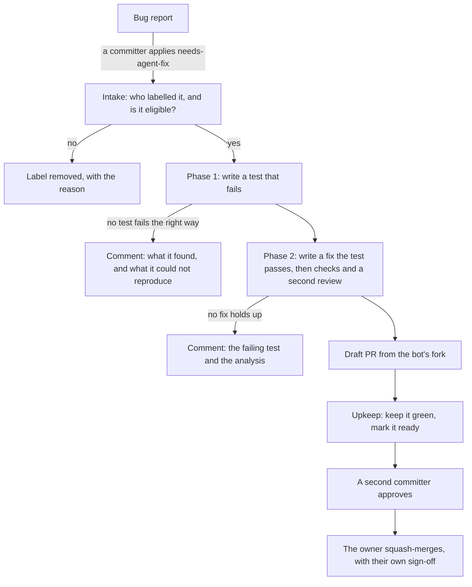
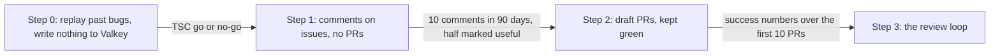
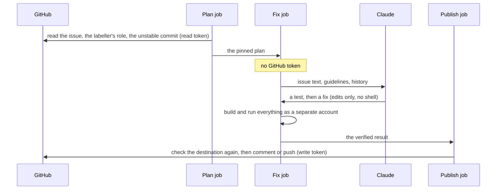
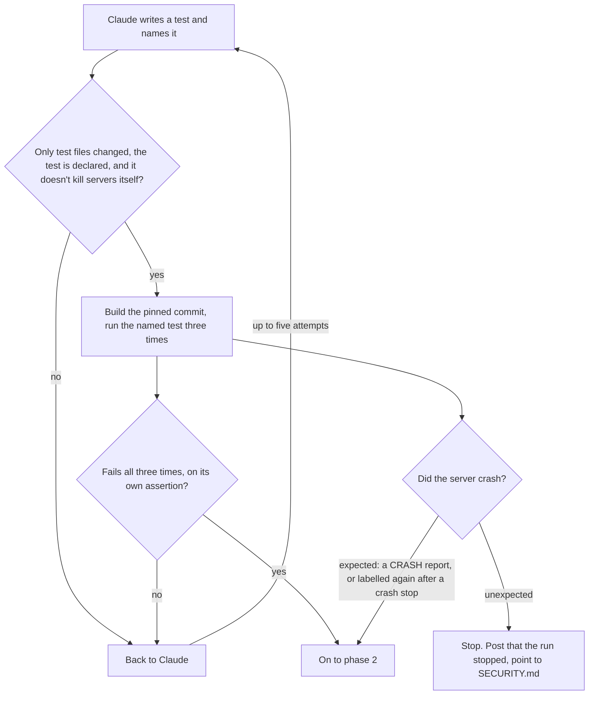
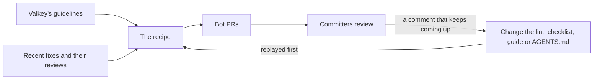
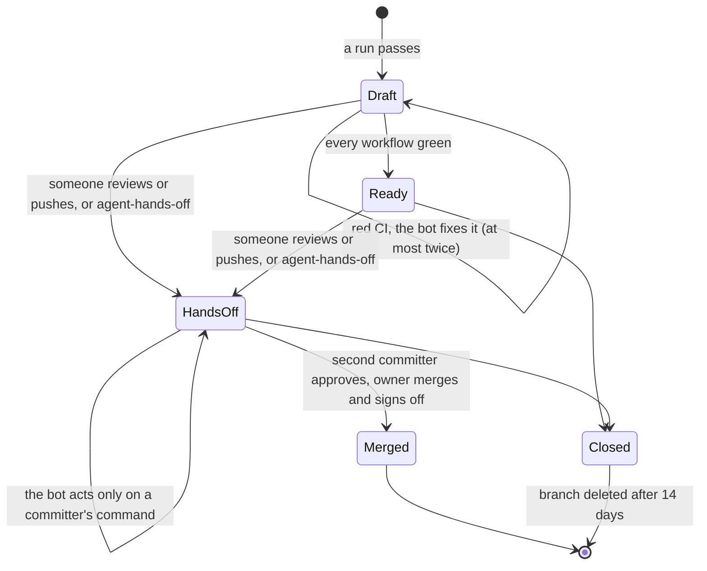
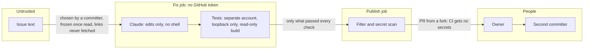
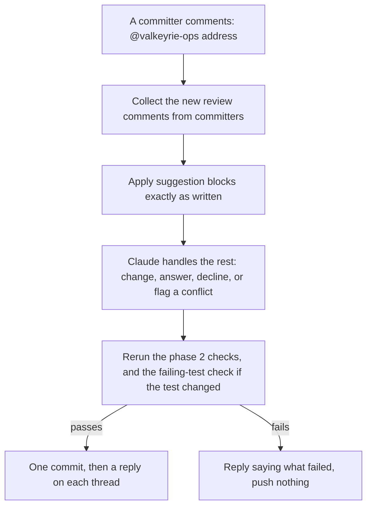

# A software factory for Valkey

*From a labelled issue to a pull request a committer is willing to own.*

Status: proposal, not built yet. Author: Sarthak Aggarwal. Draft of
11 November 2026, written against `main` at `b1b87c6f`.

If you are on the TSC, the first four sections are the ones to read:
[the idea](#the-idea), [what we need you to decide](#what-we-need-the-tsc-to-decide),
[how it rolls out](#how-it-rolls-out) and
[what to expect](#what-to-expect). Everything after that is the detail
someone needs in order to build it.

## The idea

A committer looks at a bug report, decides it is a real bug the bot can
take, and puts the label `needs-agent-fix` on it. The bot writes a test
that fails because of the bug, then writes the change that makes the test
pass. If both hold up, it opens a pull request that says `Fixes #N`.

That committer owns the pull request from then on, the same way they would
own one they had written. They answer the reviewers, a second committer
approves it, and the owner merges it with their own sign-off. While the PR
waits, the bot keeps it green. Later in the rollout it also applies review
comments when a committer asks it to. It never merges anything.

### Why do this at all

Each of us now has our own prompts and our own setup for generating code,
and each of us has a different idea of when the result is good enough. The
point of this is to stop relying on individual setups and settle on one
on purpose: one recipe, kept in a repository, reviewed like code, reading
Valkey's own guidelines, running the same checks every time, with its
results measured in one place. A standard process is what lets us improve
it.

It is not about speed. In a sample of recently closed bugs, a person had
opened a fix for most of them within a day. The slow part of Valkey's
process is review, so most of this design is about spending as little
review time as possible.

### Three rules

These hold everywhere in the design. If a later section seems to bend one,
the later section is wrong.

1. **Nothing the bot writes is pushed until code has built it and run its
   test.** A change that cannot be verified is posted as a comment, or not
   at all.
2. **Every bot PR has a person who owns it,** and the bot never merges or
   approves.
3. **Only committers can direct it,** on issues and on its own PRs.

### What it costs

For each bot PR: an owner who reads it as if it were their own, a second
committer who reviews and approves it, and someone approving the DCO
check by hand, as we already do on the bot's backport PRs. To keep that
cost down, the bot hands its PRs over green, never has more than five open,
and stops pushing on its own as soon as anyone has reviewed.

Building it is a real project, not a configuration change. The first three
steps are each a substantial piece of work; [the work](#the-work) lists
what each one needs.

## What we need the TSC to decide

| # | Question | What I propose | Needed before |
|---|---|---|---|
| 1 | **Certification.** A bot cannot sign the DCO. | The owner certifies the change as an AI-assisted contribution of their own. When they squash-merge, they add their `Signed-off-by` and an `Assisted-by:` line naming the model. The squash commit will probably name the bot as its author, so the owner signs off as someone who is not the author. I'd like the TSC to confirm this reading of the DCO, with Linux Foundation counsel if it wants. If the answer is no, we stop at step 0, because step 1 already invites people to reuse the bot's patches. | Step 1 |
| 2 | **Where the bot's branches live.** | In principle, in a fork, so the bot's PRs get exactly the trust an outside contributor's get. For committers to be able to push to it, the fork has to belong to a user account, so a machine user whose credentials somebody holds. I'll propose the owner and the credential holder before step 2, once the checks in [verify first](#verify-first) are done. | Now in principle; the owner before step 2 |
| 3 | **Who may apply the label.** | Committers, as GOVERNANCE.md defines them: anyone with write access. Applying the label is also the security call. If you think a bug might be a vulnerability, you follow `SECURITY.md` instead, exactly as you would for a fix you wrote. | Step 1 |
| 4 | **Who runs it.** | I operate it, with a second operator named before step 1. Admins of `valkey-io/valkey-ci-agent` can turn it off. Any committer can cancel one issue by removing the label, or stop the bot pushing to one PR on its own with the label `agent-hands-off`. Changes to the recipe are PRs to `valkey-ci-agent`, reviewed like any other. | Step 1 |
| 5 | **Spend, and the model vendor.** | The bot uses Claude through the AWS account it already uses, and the TSC should know who funds that account. Step 0 runs under a budget the TSC sets and tells us what one run costs. Before step 1 the TSC sets a monthly ceiling, which becomes a cap on runs per month. | Step 0 |
| 6 | **Go or no-go.** | Step 0 replays the 40 most recently closed `bug` issues that a merged PR fixed. The TSC then decides whether to go on. I propose a pass mark of one publishable fix in every five cases, with *publishable* defined under [step 0](#step-0). | Step 0 |

Every other limit and threshold in this document is a starting value. I'll
set them, and report on how they hold up.

## How it rolls out

Each step is switched on by a repository variable, and each one has to
earn the next.

**Step 0, the replay.** The recipe runs against past bugs, and nothing is
written to `valkey-io/valkey`. It tells us how often the bot would have
produced something worth publishing, and what that costs. This is the go
or no-go point.

**Step 1, comments.** The label works on `bug` issues and on the
detector's `test-failure` issues. A run posts its test, its analysis and
its patch as a comment on the issue, with no branch and no PR. This alone
may be worth keeping for a long time: a failing test on a bug nobody has
looked at helps whoever picks it up. It moves on when, within 90 days,
there are at least ten such comments and their owners marked at least half
of them useful with a 👍.

**Step 2, pull requests.** A labelled run that passes opens a draft PR,
and upkeep keeps it green and marks it ready. It moves on when the
[success numbers](#measuring-it) hold over the first ten PRs.

**Step 3, the review loop.** A committer can ask the bot to apply review
comments, or to bring a PR up to date with `unstable`. That is described
in [step 3](#later-step-3-the-review-loop).

The detector keeps posting its automatic patch comments throughout. Only a
labelled run opens a PR, because only a labelled run has an owner.

### Rolling back

Before it opens a PR, the bot checks two things. Has a merged bot PR been
reverted on `unstable`? Were the last three bot PRs closed without
merging, not counting one that a person's fix landed ahead of, or whose
issue turned out to be `not-a-bug`? If either is true, it posts a comment
instead, and keeps the PRs that are already open green. To lift the hold,
the operator writes down what went wrong and sets the repository variable
`FACTORY_HOLD_CLEARED` to that day's date, after which older events no
longer count.

## What to expect

For this document I read two samples of past work. Nothing was run, so
"would fail first" below is a judgement from reading the diffs. Sampling
closed issues also favours bugs that were fixed quickly.

| | |
|---|---|
| Of the 32 PRs that fixed the 40 most recently closed `bug` issues: how many came with a test | 26 |
| … how many had a test that would plausibly fail first on one Ubuntu machine | at most 21 |
| … how many a person opened within 24 hours of the issue | 23 |
| … median days from opening to merge | 6.5 |
| Of about 20 fix PRs merged between 23 October and 10 November: crashes, assertions or leaks, fixed in public with a reproducing test | 8 |
| Open PRs in `valkey-io/valkey` today, and how many await review | 448 and 411 |
| Open `bug` issues today, unassigned, with no linked PR | 20 |
| Open `test-failure` issues today, unassigned, with no linked PR | 23 |

What I take from this:

The pool is small. The bot only takes labelled issues, and a lot of
Valkey's fixes arrive as a PR with no issue behind them. It also needs a
bug that one test on one Linux machine can show, which rules out leaks,
other platforms, multi-node timing, performance and redesigns.

The gain is not volume. It is the shared recipe, fixes for bugs nobody has
picked up, and failing tests that are useful to a person even when the
bot's fix is not.

Review is what everything else has to protect. Each limit in the rest of
this document exists for that reason.

---

*Everything below is reference for whoever builds this.*

## Words used here

A **committer** is anyone with write, maintain or admin access to
`valkey-io/valkey`, which is how GOVERNANCE.md uses the word. TSC members
are committers too. The **owner** of a bot PR is the committer who applied
the label. A **run** is one pass of the pipeline for one issue: plan, fix
and publish. One execution of a test is a *test run*, and one GitHub
Actions run is a *workflow run*. A **detector issue** is a `test-failure`
issue that the bot's Test Failure Detector filed after a test failed in
Daily CI.

A **crash** is a server process ending on SIGSEGV, SIGBUS, SIGILL, SIGFPE
or SIGABRT (a failed `serverAssert` raises SIGABRT), or a sanitizer
report. A timeout is an ordinary failure, not a crash.

## How a run works

The bot keeps no database. Every stage reads the current state from
GitHub and acts on that.

### Picking up the label

Twice an hour a scheduled job lists the open issues that carry
`needs-agent-fix`. For each new one it reads the `labeled` event in the
issue's timeline, which records who applied the label, and checks that
person's role on the repository there and then. They need `write`,
`maintain` or `admin`. The event's id is the key, so each application of
the label is handled exactly once.

The bot takes the label off again, and replies saying why, when:

- the person who applied it has any other role, is a bot or an App, or the
  check fails for any reason at all;
- the issue is closed or locked;
- it is neither a detector issue nor labelled `bug`;
- someone is assigned, or an open PR says it `Fixes`, `Closes` or
  `Resolves` the issue;
- it carries `major-decision-*`, `breaking-change`, `pending-refinement`,
  `not-a-bug`, `help wanted` or `good first issue`. The last two are meant
  for people;
- someone who is not a committer edited the title or body in the hour
  before the label went on, or after it and before the run read the
  issue. A reporter must not be able to change what the bot acts on after
  a committer has read it;
- three runs have already started for it since it was last opened (an
  automatic restart does not count);
- this month's cap on runs is used up.

Otherwise the issue waits with the label on. It starts once fewer than two
runs are in progress and, from step 2, fewer than five bot PRs are open.
Detector runs share those two places, and labelled issues go first.

The bot posts one status comment and edits it as it goes, with a link to
the revision of the issue it read. Removing the label cancels the run: the
publish step checks for the label, and if it has gone it posts nothing and
marks the status comment cancelled. Whether someone in the thread has
already offered to take the issue is for the committer applying the label
to judge.

### What Claude gets to read

It reads the issue's title and body, and the comments written before the
label went on that have not been edited since. All of that is marked as
untrusted text, except that comments by committers are marked as
direction. It never follows links. It also reads Valkey's own guidelines
from the pinned commit of `unstable`, and the history: merged commits that
mention the issue or touch the files it names, and the most recent merged
fixes to those files together with their review comments. Why that matters
is covered in [meeting the reviewers' standard](#meeting-the-reviewers-standard).

### Three jobs, and who holds what

A run is the same three jobs the CI fix bot uses today. The middle one,
where Claude works, has no GitHub token at all.

**Plan** pins down the issue as it was read, the owner, and the commit of
`unstable` to work on. **Fix** does the work. **Publish** checks the
destination again, and only then writes.

A detector issue goes through the existing engine, with its failed CI job
as the evidence. Detector failures are mostly flaky tests, and flaky tests
don't fail on demand. So for them the engine shows that the test passes
repeatedly with the fix, up to 40 times and fewer for valgrind or slow
tests, and does not try to show it failing first. Everything from here on
is about `bug` issues, where a failing test is the only evidence that
there is a bug at all.

### What counts as a test

A named test case that one of Valkey's runners reports by name:
`./runtest` for the Tcl tests under `tests/unit/` and `tests/integration/`,
`./runtest-moduleapi` for `tests/unit/moduleapi/`, and the unit-test binary
for `TEST` and `TEST_F` cases under `src/unit/`. The name has to be
written out literally, not built while the test runs. Sentinel tests are
out of scope.

### How things are built

A separate account does the compiling, including the test modules and the
TLS test certificates. The tree is then made read-only to the account that
runs the tests, apart from a fresh `tests/tmp`, so a test cannot change the
server between one test run and the next. A unit test lives inside the
unit-test binary, so that is rebuilt on every attempt. Test commands run
with no network other than loopback.

### Phase 1: a test that fails

Claude writes a test. It may add helpers, fixtures or test modules
anywhere under `tests/` or `src/unit/`, and it tells us the test's name.
Code then checks that an added line declares the test (`test {name}` in
Tcl, `TEST` or `TEST_F` in C++), that nothing outside those two directories
changed, and that the test does not kill or crash servers on purpose. That
means no `exec kill`, no `DEBUG SEGFAULT` and no `DEBUG ASSERT`.

Then code builds the pinned commit and runs the named test three separate
times. The test counts only if all three runs fail in the right way. The
runner has to report the failure for that test by name: an `[err]` from
runtest, with no `[exception]` and no timeout, or a `[  FAILED  ]` line
from the unit-test binary. The failure must not just be something the test
uses that does not exist yet. Code catches the plain cases, unknown
commands and subcommands and build failures, and the reviewer session is
told to look for the rest. And the server must not have crashed, which
code checks by reading the server logs runtest keeps for the test
(`--dump-logs`) for Valkey's crash report and for sanitizer reports.

A crash is fine when the owner labelled the issue knowing it was one,
meaning the title starts with `[CRASH]` (the prefix Valkey's crash-report
template uses), or an earlier run on it stopped on a crash. In that case
the test runs on an AddressSanitizer build, and a crash there counts as
the failure, including the `[exception]` runtest reports for it. Any other
crash in phase 1 stops the run, for the reasons in
[crashes](#crashes).

If the test doesn't count, the output goes back to Claude. It gets five
attempts in all.

### Phase 2: a fix that the test passes

Claude now writes the fix. Code has recorded a hash of every file phase 1
wrote, and those files must not change. Neither may the test harness
(`tests/support/`, `tests/helpers/` and `tests/test_helper.tcl`) unless
phase 1 changed it. Claude may change other existing tests, but only by
listing each change and saying why. The usual reason is a test that
asserted the buggy behaviour. The reviewer session checks each one, and
the PR body lists them.

Then code runs six checks, in this order:

1. **Green.** The test passes ten times in a row on the default build,
   after one build. If ten won't fit in the time left, the attempt fails.
   There is no shortcut to fewer.
2. **Memory.** The test passes once on an AddressSanitizer build with no
   report, and code checks the binary really was built with it.
3. **Neighbours.** Every test file phase 1 added to or phase 2 changed runs
   whole, once.
4. **The cheap parts of CI.** A default build with `-Werror`,
   `clang-format` 18.1.8, the generated files `ci.yml` checks are up to
   date, and the lint described under
   [meeting the reviewers' standard](#meeting-the-reviewers-standard).
5. **Bounds.** Nothing under `.github/` or `deps/`, no new file under
   `src/commands/`, and a patch under 45,000 characters (the limit the bot
   already uses for suggested patches) so the reviewer session can read all
   of it. This keeps PRs focused. It is not a security boundary.
6. **Review.** A separate, read-only Claude session with the same
   guidelines reads the change and the test output, and works through the
   checklist under
   [meeting the reviewers' standard](#meeting-the-reviewers-standard).

If a check fails, including when the fix itself makes the server crash,
the output goes back to Claude once. So the fix gets two attempts.

As a starting time budget inside the engine's four and a half hours: 20
minutes for each phase 1 session, 60 for each phase 2 session, and the rest
for builds and test runs. Step 0 will tell us what is actually needed.

These checks are necessary, not sufficient. In the sample, one merged fix
passed all its tests and a reviewer still found three holes in it. The
checks are there to keep PRs that aren't worth a reviewer's time from ever
reaching one. They don't replace the reviewer.

### How a run ends

| What the run found | What the bot does |
|---|---|
| A test that counts and a fix that passes | At step 1, posts both on the issue. At step 2, opens a draft PR. |
| A test that counts, but no fix that passes | Posts the test and the analysis |
| No test that counts | Posts the analysis, and what it could not reproduce |
| An unexpected crash in phase 1 | Says the run stopped and points to `SECURITY.md`. No restart. |
| The issue needs a decision, or the fix would be out of bounds | Says which |
| A person took the issue, or the label was removed | Marks the status comment cancelled, and nothing else |
| The runner or the model failed | Restarts once, then says the run produced no result |
| The run ran out of time | Says the run produced no result. No restart. |

Afterwards it removes the label, unless someone already did. Putting the
label back on asks again, up to three runs.

### Before anything is posted

Everything the bot posts or commits is filtered first: comments, commit
messages, and the PR's title and body. Code strips `@` mentions other than
the owner's, closing keywords other than the bot's own `Fixes #N`, any
`Signed-off-by` or `Assisted-by` lines, and links. Links here include
images, HTML, and references to other issues or PRs. A patch is posted
exactly as it is, in a code block. A pinned secret scanner reads all of it,
patch included, and if it matches anything, nothing is published.

## Meeting the reviewers' standard

Honestly, no check can guarantee that a fix is the one a committer would
have written. The reviewer session is the same model reading its own kind
of work. What we can do is raise the floor, in four layers, and keep the
owner and the approving committer as the real standard.

**Valkey's own guidelines, all of them.** The bot reads `AGENTS.md`,
`DEVELOPMENT_GUIDE.md`, `CONTRIBUTING.md`, `tests/README.md` and
`src/unit/README.md`, always from the pinned commit of the target
repository and never from a branch the bot wrote. If one is missing, the
run's report says so. It leaves out the files under `.github/instructions/`.
Those were added for GitHub Copilot's reviews, they say they are derived
from `DEVELOPMENT_GUIDE.md`, and most haven't changed since. A stale copy
that disagrees with its source would only mislead. The bot's own guide in
`scripts/ci_fix/guides/` adds policy, not conventions, and any of its
advice that applies to everyone should move into Valkey's `AGENTS.md`,
where every contributor's tools will read it.

**How committers actually write and review these files.** Guidelines say
what the standard is. Examples show it. So the bot also gets the two or
three most recent merged fixes to the files it is changing, with the review
comments those PRs got: what reviewers accepted, and what they pushed back
on.

**Mechanical checks, for whatever a machine can decide.** Formatting,
`-Werror`, generated files and the size limit are already in phase 2. On
top of those, a short lint enforces the rules from the guidelines that
reviewers keep having to repeat. One example is waiting with
`wait_for_condition` instead of a fixed `after`. The lint's rules live in
this repository, and each one cites the guideline it comes from.

**A checklist, for what a machine can't decide.** The reviewer session
rejects a change that isn't the smallest one that fixes the cause, that
doesn't match the surrounding code or brings in a new pattern, that puts
the test in the wrong place or tests something easier than the issue
claims, that leaves non-obvious behaviour without a comment saying why,
that would be hard to backport, or that changes an existing test without a
reason that holds.

And then we close the loop. When the same review comment keeps coming up
on bot PRs, it becomes a change to the lint, the checklist, the bot's
guide or Valkey's `AGENTS.md`. The replay runs the recipe before that
change ships, so a correction made once doesn't have to be made again.

### Modules

When the factory takes on the modules, each repository gets its own
profile rather than sharing Valkey's rules. A profile holds that
repository's guideline files, the bot's guide for it, what counts as a
test and which runner runs it, the build and format commands, and the lint.
This document fills in one profile, for `valkey-io/valkey`, but the code
treats it as a profile from the start, so adding a module is configuration
rather than a rewrite.

The modules are not alike. `valkey-search` has an `AGENTS.md`, a
`CONTRIBUTING.md` and an `.agents/` directory. `valkey-json` and
`valkey-bloom` have only a README. A module with no guidelines needs an
`AGENTS.md`, written with its maintainers, before the bot takes its issues.

## The pull request

This is step 2.

The PR comes from the bot's fork, on a branch that is new for every
attempt: `agent/issue/<N>-<workflow run id>-<attempt>`. Because the name is
never reused, a PR that was closed can never come back with its old code.
The branch is deleted 14 days after its PR closes, so a PR closed by
mistake can still be reopened.

The body starts with a short summary meant to become the squash commit
message. Below it, inside `

AI generated details
`,
the way Valkey PRs already do it, come the root cause and what changed,
every change to an existing test and why, what code verified with the
commands and counts, what isn't established, the recipe (this
repository's commit and the model), and a suggested `release-notes` or
`no-release-notes` label. Then `Fixes #N`.

The owner is assigned. Valkey's auto-assign workflow assigns a PR's author,
so the bot swaps itself out for the owner. From then on the owner answers
reviewers' questions and automated review comments as an author would, and
decides whether the PR deserves a second committer's time.

The PR stays a draft until it is green. The bot marks it ready when every
workflow run on its head commit has finished as `success` or `skipped`,
apart from the jobs listed in `ci_followup_ignored_jobs`. That includes the
format check and the Provenance Guard, which compares PRs with Redis
source. If a job is red and the bot doesn't fix it, the bot names it on the
PR, and the PR stays a draft until a committer reruns the job or marks it
ready.

To merge, a committer other than the owner approves, and a committer
approves the DCO check by hand, since it flags the bot's commits. The owner
squash-merges, replacing the default message with the summary, their
`Signed-off-by`, and an `Assisted-by:` line naming the model. The bot posts
that message, ready to paste, when it marks the PR ready. The bot's own
commits carry neither line.

### A bot PR's life

### Keeping it green

Twice an hour, one scheduled job reads every open bot PR with a single
query. Until anyone has reviewed a PR, the bot does three things on its
own. It fixes red CI by handing one failed job to the CI fix bot, at most
twice per PR, counted by a marker on the PR. That fix may only touch files
the PR already changes, and never the files phase 1 wrote or the harness;
if it would need more, the bot names the job and leaves it. A bug-fix PR
should not quietly collect fixes for other people's flaky tests. It also
marks the PR ready, by the rule above, and deletes the branch 14 days
after the PR closes.

### Hands off

The moment anyone submits a review or a committer pushes to the branch, or
while the PR has the label `agent-hands-off`, the bot stops pushing on its
own. It still does what a committer asks: `@valkeyrie-ops fix`, which on
bot PRs needs a committer, and from step 3 `address` and `update`. A push
by a person makes this permanent.

Right before every push the bot reads the PR again: the head commit, the
reviews, the label and auto-merge. If auto-merge is on, it pushes nothing,
whoever asked. If a push follows an approval, the bot dismisses that
approval and says why. `unstable` doesn't dismiss stale approvals by
itself, and an approval should mean the code that was actually read. If
the App isn't allowed to dismiss reviews, it turns the PR back into a draft
instead.

The bot never closes a PR. The weekly report lists bot PRs with no
activity for 30 days, and the owner decides what to do. If the owner leaves
or stops answering, another committer takes over by assigning themselves.
Until step 3 there's no `update`, so if a PR conflicts, the owner closes it
and can put the label back for a fresh run on the current `unstable`.

## Keeping it safe

Most of the containment already exists, because the CI fix bot needed it.
Claude has no GitHub token and no shell. It edits a scratch checkout as a
separate system account. Code builds, tests, commits and pushes, and only
pushes if the branch is still at the commit the run started from. Test
commands get no credentials. The model's own process holds short-lived AWS
credentials for Bedrock, and nothing else.

Everything the model reads is public already. What it writes, including
any test that happens to crash the server, is kept by the model provider
under the AWS account's data-sharing setting, which the default model
requires (see `docs/setup.md`).

What is genuinely new is the input. Until now, what the bot pushed came
from CI logs, and on other people's PRs it only ever suggested patches. A
bug report is text anyone on the internet can write, and a hostile one may
well try to steer Claude. The design assumes that will sometimes work, and
limits what can follow from it.

A committer chose the issue, and nobody else can change it afterwards.
Links are never fetched, and only committers' comments count as direction.
The test and the fix have to pass code's checks and a second session's
review. Tests can't reach the network or change the built server.
Everything published is filtered and scanned. On a fork, the PR's CI runs
without secrets. And an owner and a second committer read the change
before it merges.

### Why a fork

Today the bot pushes its branches to `valkey-io/valkey` itself. A branch
there runs CI as soon as it is pushed, before anyone has read the diff, in
jobs that hold the Codecov token and CodeQL's write permission. A PR from a
fork gets no secrets and a read-only token. Valkey's own `AGENTS.md` also
says never to push to the upstream repository. So bot PRs for issues come
from a fork.

The token the bot uses on `valkey-io/valkey` for these PRs only asks for
pull request and issue write, and merging needs write on contents. The App
itself still has that permission, for backports, so this rests on how the
workflow asks for its token rather than on anything GitHub enforces.

Committers push fixes to contributors' branches today, and they should be
able to do the same here. GitHub allows that on a fork owned by a user
account, but not on one owned by an organization, which is why the fork
belongs to a machine user (decision 2). Both the engine, which publishes
with one token to one repository, and the CI follow-up, which refuses fork
heads, have to change for this.

### Crashes

Valkey fixes crashes in public, with a test that reproduces them, and the
bot does the same. Applying the label is the security call: if a committer
thinks a crash might be a vulnerability, they follow `SECURITY.md` instead.

The one case the bot guards against is a crash nobody expected. The owner
labelled what looked like a wrong result, and the test crashes the server.
Then the run stops. The bot only says that it stopped and points to
`SECURITY.md`, and it doesn't restart. The owner has to judge from the
issue alone, because the bot has no private channel to show them the test.
If they decide it isn't a security concern, they put the label back, and
the next run treats a crash as the expected failure.

So that nothing leaks before that call is made, runs on `bug` issues write
no session or test output to the workflow log, in any part of the code.
Results are kept outside the folder that gets uploaded, and copied into it
only once code has classified the run. A run that stopped on a crash
uploads only its outcome, and a run that is cancelled or dies uploads
nothing.

To be clear about the limits: crash detection reads logs that the test's
own servers write, so a test written to hide a crash can still hide one.
The reviewer session and the people are the remaining check. With crashes
fixed in public anyway, hiding one gains very little.

If a bot PR later turns out to touch a vulnerability, the owner closes it,
the branch is deleted straight away, and `SECURITY.md` is followed. The
commits stay reachable on the fork by their hashes, as they would on any
public fork.

### Certification

A bot can't certify where code came from, so its commits carry no
sign-off. The DCO check can't make sure a person does it either. The DCO
app skips merge commits and anything authored by a bot account. It only
flags the bot's commits today because their author email doesn't match any
GitHub account, and on backport PRs a committer then approves the sign-off
by hand (PR 5335 shows "Commit sign-off was manually approved"). If that
email were ever corrected, the check would pass with nobody having
certified anything.

So certification is the owner's job, at merge time, as described under
[the pull request](#the-pull-request). Nothing on GitHub enforces it.
Rebase merges are allowed, and the squash message defaults to the PR body.
The owner may also be able to approve alone, because the PR's author is
the bot; a rule on `unstable` that asks for extra approval of unattributed
changes may prevent that, and we need to check. So the weekly report flags
every merged bot PR that wasn't squashed, has no `Signed-off-by` from its
owner, or was approved only by its owner.

## Limits

| Limit | Starting value |
|---|---|
| Kill switch | A repository variable in `valkey-ci-agent`. When it's off, intake leaves labels alone and upkeep does nothing. |
| Runs in progress, shared with detector runs | 2. Labelled issues go first; the rest wait. |
| Runs per month | The TSC's ceiling divided by the cost of one run |
| Runs per issue since it was last opened | 3 |
| Open bot PRs | 5. Labelled issues wait while five are open. |
| Attempts at a failing test in one run | 5 |
| Attempts at a fix in one `bug` run | 2 (detector runs keep the engine's 3) |
| Automatic CI fixes per bot PR | 2 |

When nothing is happening, it costs one listing call and one query twice
an hour, and no runner is held in between. Model time is only spent inside
runs, after code has turned away everything it can. Each push starts
Valkey's PR CI once. We don't yet know what one run costs; step 0 will tell
us.

## Measuring it

A weekly job posts the numbers as an issue in this repository.

It counts **how runs end**: a PR, a test only, nothing reproduced, an
unexpected crash, no result, or out of scope. At step 1 it counts how
**useful** the comments were, from the owners' 👍 and 👎. Where a person
later fixed the issue, it also runs two cross-checks: does the bot's test
fail before that fix and pass after it, and does the person's test pass
with the bot's patch?

For each merged bot PR it records the **reviewer cost**: the review
comments, and the committer actions it took (approvals, DCO approvals and
workflow approvals), next to human bug-fix PRs of a similar size merged in
the same weeks. It tracks **review comments that keep coming up**, which
feed the loop in [meeting the reviewers' standard](#meeting-the-reviewers-standard).
It counts PRs **accepted as written**, meaning merged with no change pushed
by a person, alongside those merged after a person's changes, superseded by
a person's PR, or closed. And it tracks how many PRs were **green on
arrival**, how many were **regretted** (reverted, or their issue reopened,
within 60 days), and any **certification** gaps: merged bot PRs that
weren't squashed, lack the owner's sign-off, or were approved only by the
owner.

Step 2 counts as a **success** if, over the first ten bot PRs that are
merged or closed, at least half were merged, at least three of those were
accepted as written, and the reviewer cost per merged PR was no higher than
for comparable human fixes. It's confirmed 60 days later if none was
reverted.

A **revert** is a commit on `unstable` that names a bot PR or its squash
commit in any of the ways git and GitHub write it: `This reverts commit
<sha>`, `Reverts valkey-io/valkey#N`, or a `Revert "<title>"` subject.

## The work

The overall shape of the pipeline and its containment carry over. The fix
engine doesn't, as it stands, because every part of it assumes a failed CI
job. Roughly, step 0 is large, step 1 is medium to large, and step 2 is
large.

### Step 0

**The replay.** It builds on the eval on the `ci-fix-replay-eval` branch,
but that eval needs a failed CI run with a live log for every case, scores
by how many lines overlap, never runs the person's test, and records no
cost. The replay needs something different.

Its cases are the 40 most recently closed `bug` issues that a merged PR
fixed, with none removed by hand, and a case that turns out to be out of
scope counts as a failure. A few extra cases carry hostile text planted in
the issue, and are scored separately. Each case sees only what the issue
said before the fix was opened, and `unstable` at the fix's parent commit;
the history search reads nothing later.

A case is **publishable** if the run ends with a test that counts and a fix
that passes every check, and, where the person's fix came with a test that
fails on the fix's parent commit, that test also passes with the bot's fix.
The denominator is every case. The replay also records each run's cost and
what a reviewer would have had to read. It writes nothing to
`valkey-io/valkey`.

**A new way into the engine for `bug` issues.** Today the engine's task
model needs a CI run, a job and a job log. It fixes its verification plan
before Claude starts, its fallbacks are built around "did not pass", and
its prompt is about fixing a failed job. A `bug` run has none of that. In
the new path, phase 1 names the test, code plans its command once with no
fallbacks, and phase 2 reuses that plan. Today's loop also drops to fewer
test runs when one is slow; the ten-run rule doesn't.

**The two phases** as described above: checking the test, three failing
runs, classifying the failure, the crash rule, freezing phase 1's files and
the harness, and listing changes to existing tests.

**The guidelines.** The bot reads the files listed under
[meeting the reviewers' standard](#meeting-the-reviewers-standard). Today
the engine reads `.github/instructions/integration-tests.instructions.md`
and doesn't read `src/unit/README.md`, so both change. It also needs the
recent fixes with their review comments, the lint and the checklist, all
read through a per-repository profile.

**The runner.** A build account and a read-only tree; AddressSanitizer and
default builds; googletest, which the bot's runner doesn't install today;
`clang-format`; and test commands in a loopback-only network namespace.
Today the runner hands the whole checkout to the test account and has no
network controls at all.

### Step 1

**Label intake.** Reading the timeline event and checking the role,
refusing bots, the edit rule (from the issue's edit history and its
`renamed` events), the eligibility list, the queue, and counting runs per
issue and per month by workflow-run name. The detector dispatcher only
counts active runs among the last hundred, so this needs its own record.

**Starting runs.** `ci-fix-issues.yml` and its dispatcher already start one
run per detector issue, two at a time. They extend to `bug` issues and to
labelled detector issues. A labelled detector issue that already has a
patch comment gets a fresh run, and if its logs have expired, the run is
refused and says so.

**The controls.** The kill switch, the restart rule, and the rollback hold
variable.

**Publishing to any issue.** Publication currently requires a detector
marker on the issue, and keys its result record by a CI run. Both change.

**Quiet runs.** Today the model's session goes to the workflow log as it
runs, and into the uploaded evidence. The engine logs failed test output
and the feedback it sends. A refusal's text quotes test output. Publish
prints the result to the log and the job summary. An upload with no files
fails the job, which is then counted as a failed run. For `bug` runs, each
of those changes as described under [crashes](#crashes).

**The publication filter, the secret scanner, and the weekly report.**

### Step 2

**Choosing per run** whether to comment or open a PR. Today one repository
variable decides that for every detector issue.

**The fork.** Pushing to it and opening PRs across repositories, with a
token per repository, and `agent/issue/` added to the branches the bot may
write to.

**The upkeep job.** The ready rule, the two CI fixes and their marker, the
hands-off rule and the reread before every push, reassigning the PR to its
owner, dismissing approvals, and the rollback check.

**CI fixes on fork heads.** The CI follow-up only works on bot PRs into
registered release branches and refuses fork heads, and `fix` falls back to
an unverified suggestion on a fork head. Both change for bot PRs, where
`fix` is authorized by role rather than by membership of the `contributors`
team.

**One concurrency group per issue, shared with its PR.** Today a detector
issue and its PR use different ones.

**Reviewer cost, acceptance and certification** in the weekly report.

Every action has to be safe to run twice: run again from the same state,
it must not push twice or post twice. The tests for each step show it.

### Verify first

Each of these gets checked on a test fork before the step that relies on
it.

| Before | What to check |
|---|---|
| Step 0 | Valkey's tests pass with loopback-only networking and a read-only tree, with the test modules and TLS certificates built beforehand. |
| Step 1 | The App's installation token can read an issue's edit history and timeline. |
| Step 2 | Whether a PR from the bot's fork needs a committer to approve its workflow runs every time. |
| Step 2 | Whether the App's token for `valkey-io/valkey` can open a PR whose head is in a machine user's fork. |
| Step 2 | Whether committers can push to that fork's branch, and whether a fork inside `valkey-io` would be allowed and get no secrets. |
| Step 2 | Whether the App can mark a PR ready, reassign it and dismiss approvals with pull request write alone. |
| Step 2 | Whether pushing to the fork needs the `workflows` permission when the push carries `unstable`'s workflow changes. |
| Step 2 | What the `unstable` rule "require extra approval for unattributed changes" means for a PR from an App whose commits match no account. |
| Step 2 | Who GitHub records as the author of a squash commit for an App's PR. |

## Later: step 3, the review loop

Step 3 adds two commands on a bot PR. Only committers can use them, and the
comment poller picks them up within about an hour. Each is a request to
push, so the hands-off rule doesn't stop them. Auto-merge does.

**`@valkeyrie-ops address`** applies review comments. The batch is every
inline thread whose newest committer comment is newer than the bot's last
reply in it, plus every review summary submitted since the last `address`
it handled. Comments from other people and other bots aren't instructions,
unless the owner says so in a comment of their own. `suggestion` blocks are
applied exactly as written, by code. For everything else, Claude returns a
change and, for each comment, one of four answers: changed, answered,
declined with a reason, or conflicting, when two committers asked for
incompatible things. On a conflict it changes nothing for those comments
and names both people.

Then the phase 2 checks run again. If the test changed, code runs it on
the merge base of the PR and `unstable` with only the files under `tests/`
and `src/unit/` applied, and it has to fail the way it did in phase 1. If a
committer told the bot to remove the test, the committer wins: what's left
is still built and run, and the PR body says the fail-then-pass evidence no
longer applies. The bot pushes one commit and replies on each thread. It
never resolves a thread; that's the reviewer's call.

**`@valkeyrie-ops update`** brings the PR up to date with `unstable`. The
bot never does this unprompted, since `unstable` doesn't require it. Code
runs `git merge`. Files that merge cleanly are taken exactly as git
produced them, only files with conflicts go to Claude, and code checks that
nothing else changed. The checks run again, with the bounds measured
against the merge base so that `unstable`'s own `.github/` changes don't
count against the PR. If the test now passes without the fix, someone else
fixed the bug, and the bot says so instead of pushing. It posts how the
PR's change differs before and after the update. The branch is never
rewritten, and since Valkey squashes, the merge commit never reaches
`unstable`.

The work for step 3 is parsing the two commands; pushing a merge commit,
which today's push code can't do, with the `workflows` permission it may
need; and reading and replying to review threads, which the release notes
watcher already does for one file.

One question is left for step 3 itself: should these happen without a
command, whenever a review is submitted? That would be quicker. It would
also push in the middle of reviews that arrive one comment at a time. In
the sample, most reviews involved two or more people, and about a third of
the comments were design questions rather than requests to edit.

## Alternatives we considered

**A comment command instead of a label.** A comment can carry a hint. But a
label is a queue anyone can see, it waits patiently when the bot is busy,
and removing it cancels. Its one weakness, that people with triage access
can apply labels, goes away once the bot checks who applied it.

**Letting whoever merges certify, with nobody owning the PR.** Simpler,
but it asks a person to sign for code they may only have looked at when
they pressed merge. Valkey's `CONTRIBUTING.md` says the person who submits
code owns its quality.

**Branches in `valkey-io/valkey`, the way backports work.** Simpler again,
at the cost of CI running bot-written code with secrets before anyone has
reviewed it.

**Holding back every crash.** Stricter than the project is with itself, and
it would throw away many of the bugs the bot could actually fix.

**Running `bug` runs in a private repository.** That would hide even an
unexpected crash, but it means a second deployment to keep in step with
this one.

**Reading the Copilot instruction files as well.** More guidance, at the
risk of following a stale copy instead of the source.

**Putting `run-extra-tests` on every bot PR.** Wider coverage, but Daily's
flaky tests would keep the PRs red. A committer can still add the label.

**Closing idle bot PRs automatically.** With hundreds of human PRs waiting
weeks for review, this would mostly close good PRs that nobody had got to
yet.

**Rebasing and force-pushing to update.** A tidier history that gets
squashed away anyway, in exchange for reviewers losing their place.

**Reacting to events instead of polling.** Seconds instead of half an hour,
in exchange for a workflow and a key living in the Valkey repository.

**Counting a flaky reproduction.** One failure in forty test runs isn't an
estimate of anything. Phase 1 asks for three out of three.

**Opening PRs without a failing test.** That would accept fixes for bugs
nobody has demonstrated.

## Appendix: what I checked

All of this was read from GitHub or from this repository's source on
11 November 2026.

**`unstable`'s rules.** DCO is the only required status check. A branch
doesn't need to be up to date to merge. One approval is required, history
is linear, stale reviews aren't dismissed on push, and "require extra
approval for unattributed changes" is on.

**Merging.** `valkey-io/valkey` allows squash and rebase merges but not
merge commits, and allows auto-merge. The squash message defaults to the PR
body.

**Governance.** GOVERNANCE.md defines committers as people with write
access, and maintainers as people with full access, who make up the TSC.
On the repository, `contributors` (43 members) has triage access,
`valkey-release` write, `valkey-committers` maintain, and `core-team`
admin.

**DCO.** The DCO app skips merge commits and bot-authored commits. The
bot's commits carry no sign-off, and their email matches no account. DCO
shows `action_required` on open PR 5357, and "Commit sign-off was manually
approved" on merged PR 5335.

**Valkey's CI and templates.** `codecov.yml` runs on push and on pull
requests, builds and tests the branch, then uploads with
`secrets.CODECOV_TOKEN` in the same job. `spell-check.yml`, `external.yml`
and `reply-schemas-linter.yml` also run on pull requests. The crash-report
template titles issues `[CRASH]` and labels them `bug`, and the bug
template applies `bug` too. `SANITIZER=address` forces `MALLOC=libc`.
`tests/integration/logging.tcl` crashes servers on purpose. PR 5138 is a
crash fixed in public, with its trigger described and an "AI generated
details" section.

**Valkey's guidelines.** `AGENTS.md` says never to push to the upstream
repository. The `.github/instructions/` files arrived with "Add copilot
review instructions" (#3076, January 2026), and two of the three haven't
changed since; `DEVELOPMENT_GUIDE.md` changed in October. `valkey-search`
has `AGENTS.md`, `CONTRIBUTING.md` and `.agents/`; `valkey-json` and
`valkey-bloom` have only a README.

**The bot's own PRs.** None it has opened targets `unstable`.

**This repository's code.** The engine refuses to start without a CI job
and log, logs failed test output, falls back to fewer test runs when a run
is slow, and reads the guideline files noted under step 0. The runner logs
the model's session as it goes, and hands the whole checkout to the test
account. An upload with no files fails the job. Publishing to an issue
requires a detector marker. The CI follow-up refuses fork heads, and `fix`
suggests rather than pushes on them. The comment poller only understands
`fix`, which is authorized by the `contributors` team. The replay eval
isn't on `main` yet.

**Not checked.** The sample figures, apart from today's counts. Which DCO
clause applies to AI-assisted work, and how other projects use
`Assisted-by:`. And everything listed under [verify first](#verify-first).
