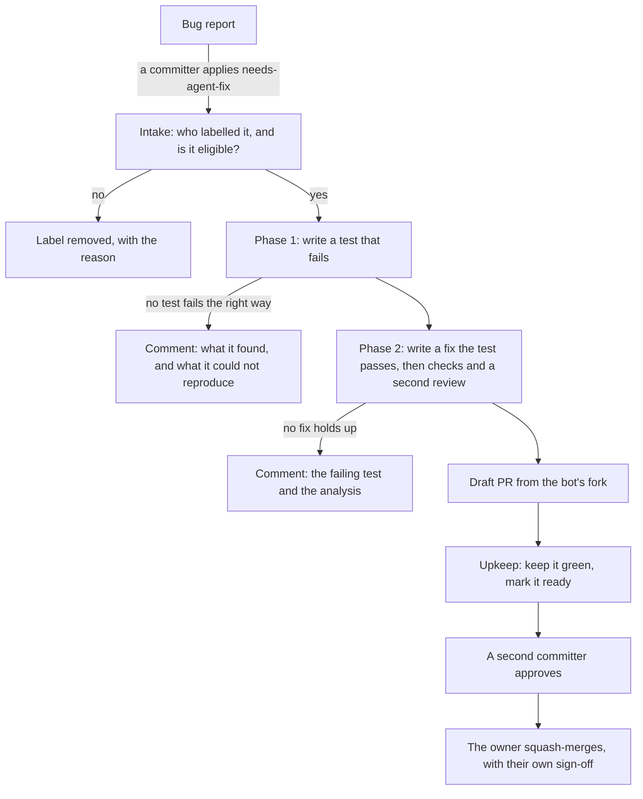
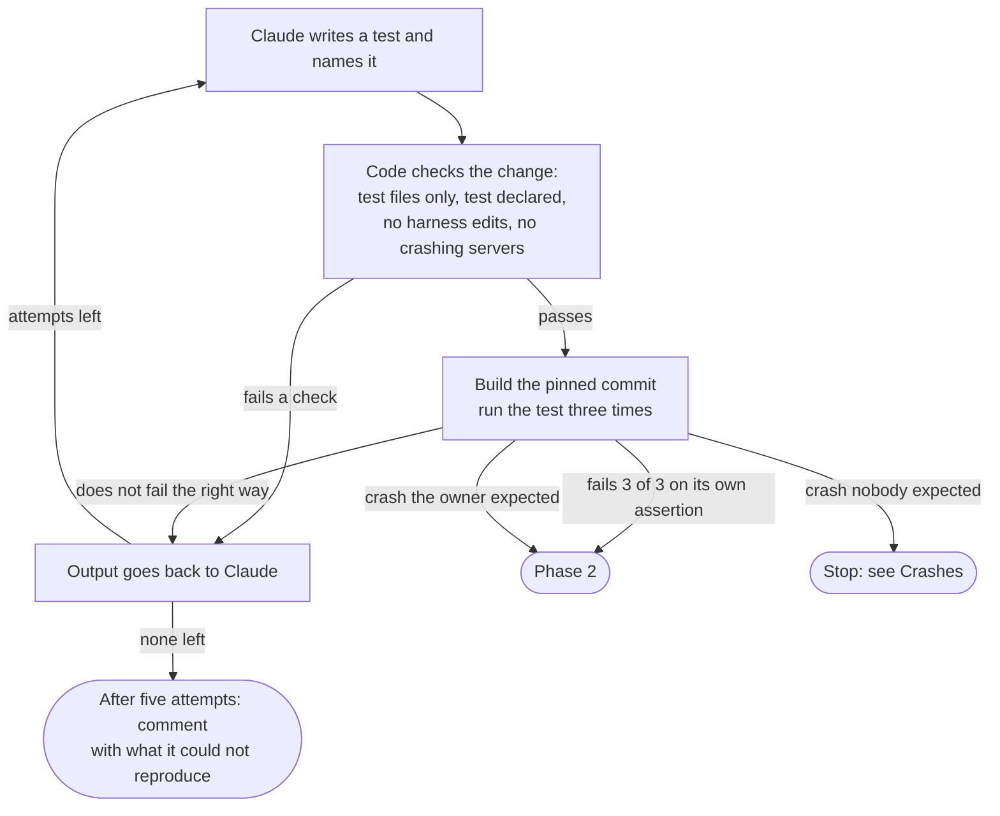
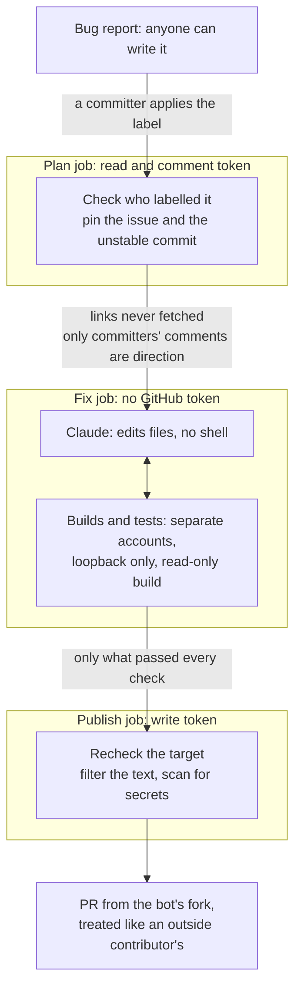
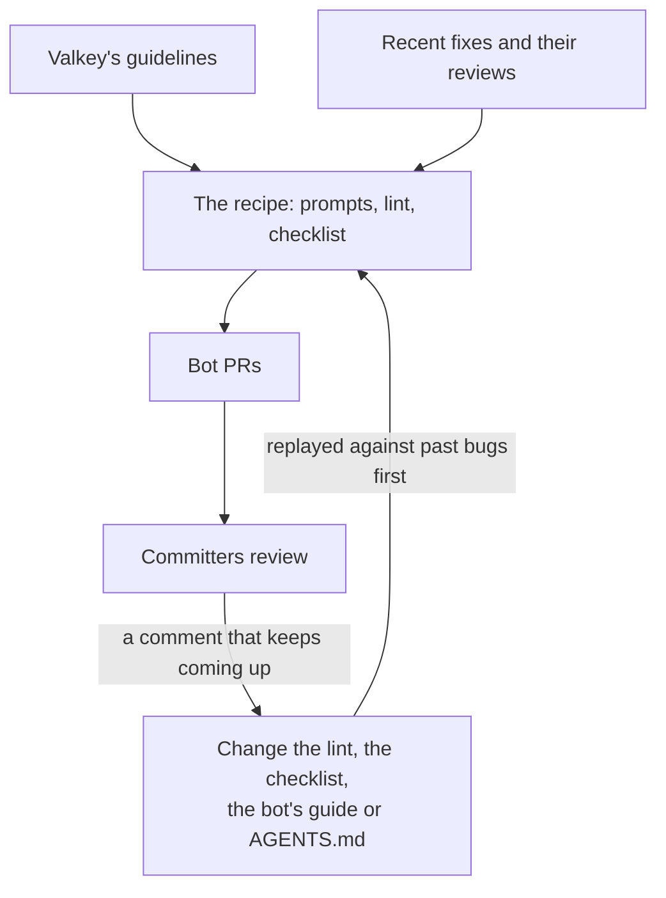
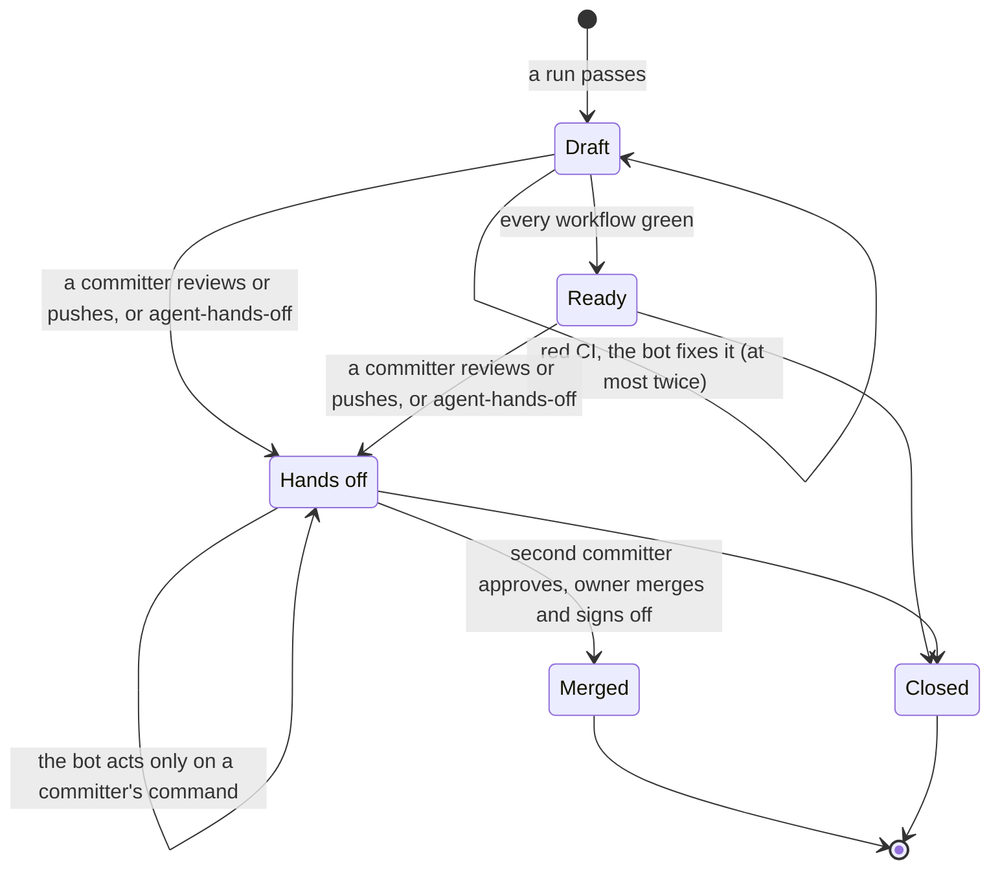

# A software factory for Valkey

*From a labelled issue to a pull request a committer is willing to own.*

Status: proposal, not built yet. Author: Sarthak Aggarwal, November 2026.

Many of us have our own prompts and setup for getting a model to write
code, each with its own idea of when the result is good enough.
That works for one person. It doesn't work for a project: nobody can see
the recipe, improve it for everyone, or say how often it is right. This
post proposes one shared recipe for Valkey, kept in a repository, reviewed
like code, and measured in one place.

The goal isn't speed: in a sample of recently closed Valkey bugs, a person
had opened a fix PR for most of them within a day. Review is the slow part
of our process, so the design spends as little review time as possible.

`valkey-ci-agent` already runs a CI fix bot
that takes a failed CI job, has Claude propose a fix, verifies it, and
posts it. This builds on that engine and its containment. What changes is
the input: a bug report, which anyone can write, instead of a CI log.

## Three rules

1. **Nothing the bot writes is pushed until code has built it and run its
   test.** A change that can't be verified is posted as a comment, or not
   at all.
2. **Every bot PR has a person who owns it,** and the bot never merges or
   approves.
3. **Only committers can direct it.** Applying the label and every command
   on a bot PR need write access to `valkey-io/valkey`, checked live. The
   trigger is a label rather than a comment because a label is a queue
   anyone can see, waits when the bot is busy, and cancels when removed.

## Evidence first: a failing test

A CI fix starts from evidence: a job that failed. A bug report is only
someone's description, so the bot's first job is to produce the evidence
itself, a test that fails because of the bug. The run has two phases.

**Phase 1: reproduce.** The test may add files, fixtures or test modules
under `tests/` or `src/unit/`, but not touch the harness (`tests/support/`,
`tests/helpers/`, `test_helper.tcl`, the unit-test Makefile). "Its own
assertion" means the runner reports the failure for that test by name: an
`[err]` from runtest with no `[exception]` or timeout, or a `[  FAILED  ]`
from the unit-test binary. A test that fails only because it calls a
command the fix hasn't added yet doesn't count.

**Phase 2: fix.** The phase 1 test is frozen: code records its hash and
checks it after every build, so the fix can't weaken what it is judged
against. Claude may change other existing tests, usually one that
asserted the buggy behaviour, but only by listing each change and why.
Then code checks that:

- the test passes ten times in a row, and once on an AddressSanitizer build
  with no report;
- every changed test file passes whole;
- `-Werror`, `clang-format` and the generated-file check pass;
- nothing under `.github/` or `deps/` changed, no command was added, and
  the patch is small enough to review in one sitting;
- a second, read-only Claude session approves it against the checklist
  below.

A failure goes back to Claude once. If nothing holds up, the bot still
posts the failing test, which helps whoever picks up the bug.

These checks are necessary, not sufficient. In the sample I read, one
merged fix passed all its tests and a reviewer still found three holes in
it. The checks keep PRs that aren't worth a reviewer's time from reaching
one.

Detector issues, the `test-failure` issues the bot's Test Failure Detector
files after a Daily CI failure, keep going through the existing engine
with the failed job as evidence. They are mostly flaky tests, which don't
fail on demand, so the engine can only show the test passing repeatedly
with the fix. Their PRs say that this is a weaker claim.

## Code decides, Claude helps

Code works out what to act on, checks everything Claude hands back, and
makes every commit and push. Claude is used only where reading and
understanding code is the task. A run is three jobs, and only the outer
two can reach GitHub.

A hostile bug report may try to steer Claude, and the design assumes that
sometimes works. That is why the issue is pinned once a committer has read
it, why the fix job has no token, why tests can't reach the network or
change the built server, and why publish strips mentions, extra closing
keywords and links from everything the model wrote.

The bot keeps no database and no state of its own. What it needs to
remember lives on GitHub: the label is the queue, the bot's status comment
on the issue records what it did, which revision it read and how many runs
it has made, a marker on the PR counts its CI fixes, and repository
variables hold the kill switch and the rollout step. Every pass rereads that state, so a run that dies leaves nothing to
clean up, and repeating a pass can't push or post twice. The markers are
bookkeeping, not a security boundary: committers can edit comments.

The PRs come from a fork owned by a machine user. Today the bot pushes
backport branches to `valkey-io/valkey` itself, where CI runs the moment a
branch is pushed, before anyone has read it, in jobs holding the Codecov
token and CodeQL's write permission. That's acceptable for cherry-picks of
reviewed commits, not for code written from a stranger's bug report. A
fork PR gets what any outside contributor's PR gets, and Valkey's own
`AGENTS.md` says agents should never push upstream. The fork
belongs to a user account because GitHub won't let committers push fixups
to an organization-owned fork. The bot's token on `valkey-io/valkey` asks
only for pull request and issue write, so it can't merge.

## Meeting the reviewers' standard

No check can guarantee a fix is the one a committer would have written,
and the reviewer session is the same model reading its own kind of work.
Four things raise the floor, and recurring review comments feed back into
them.

**Valkey's guidelines:** `AGENTS.md`, `DEVELOPMENT_GUIDE.md`,
`CONTRIBUTING.md`, `tests/README.md` and `src/unit/README.md`, from the
pinned commit. Not `.github/instructions/`: those were added for Copilot,
derive from `DEVELOPMENT_GUIDE.md`, and have mostly not changed since, and
a stale copy is worse than none.

**Recent fixes and their reviews:** the two or three latest merged fixes to
the files being changed, with the review comments they got. Guidelines say
what the standard is; these show it.

**A lint** for what a machine can decide, such as waiting with
`wait_for_condition` instead of a fixed `after`, each rule citing its
guideline.

**A checklist** for what it can't. The reviewer session rejects a change
that isn't the smallest fix for the cause, doesn't match the code around
it, tests something easier than the issue claims, leaves non-obvious
behaviour unexplained, would be hard to backport, or changes an existing
test without a reason that holds.

Advice that applies to every contributor should move from the bot's own
guide into `AGENTS.md`, where everyone's tools read it. For modules, each
repository gets its own profile of guidelines, test runners, build
commands and lint. `valkey-json` and `valkey-bloom` would first need an
`AGENTS.md`, written with their maintainers.

## The pull request, and who owns it

The owner is the committer who applied the label, or whoever takes the PR
over from them. They answer reviewers as an author would, and they merge
it.

The PR's body opens with a short summary meant to become the squash commit
message. The rest sits under `

AI generated
details
`, as Valkey PRs already do: the root cause, each change
to an existing test and why, what code verified, and what isn't
established. When the bot fixes red CI on its own, the fix may only touch
files the PR already changes, so a bug-fix PR doesn't collect fixes for
other people's flaky tests. If it pushes after an approval, it dismisses
the approval, because `unstable` doesn't and an approval should mean the
code that was read.

### Who signs the DCO

Valkey requires a `Signed-off-by`
from a known person on every commit, and a bot can't certify where code
came from, so the bot's commits carry no sign-off. The DCO check can't
enforce a human one either. The DCO app skips commits authored by bot
accounts. It only flags the bot's commits today because their author email
matches no GitHub account; on backport PRs a committer then approves the
sign-off by hand. Fix that email and the check passes silently.

So the owner certifies the change as an AI-assisted contribution of their
own: when they squash-merge, they add their `Signed-off-by` and an
`Assisted-by:` line naming the model. GitHub won't enforce that, so a
weekly report flags any merged bot PR that wasn't squashed, lacks the
owner's sign-off, or was approved only by its owner. The alternative,
letting whoever merges certify with nobody owning the PR, asks someone to
sign for code they may only have seen when they pressed merge.

## Crashes

Valkey fixes crashes in public, with a test that reproduces them, and the
bot does the same. Holding every crash back would be stricter than the
project is with itself. Whether a bug might be a vulnerability is decided
when the label goes on: if a committer thinks it might be, they follow
`SECURITY.md` instead, as they would for their own fix. For a `[CRASH]`
report, a crash is the expected failure.

The case to guard is a crash nobody expected: the test crashes the server
on what looked like a wrong-result bug, or the AddressSanitizer check finds
a memory error in existing code. The run stops and, in public, looks like
any other run that produced no result. If the TSC allows it, the test goes
into a draft security advisory that only the owner and the security team
can see. For that to hold, runs on bug reports keep the model's session and
the test output out of the public workflow log, and upload nothing until
code has classified the run.

## Rolling it out

Each step is switched on separately and has to earn the next.

**Step 0: replay.** The recipe runs on 40 recently closed bugs, closed after
the model's training cutoff, seeing only what each issue said before it was
fixed and `unstable` as it was then. Nothing is written to
`valkey-io/valkey`. A case is publishable if the bot's checks pass, the
original fixer's own test passes with the bot's fix, and a committer who
didn't write that fix says they'd own the bot's PR. It also tells us what a
run costs.

**Step 1: comments.** The label turns on, but the bot only comments with its
test, analysis and patch. It moves on after ten comments in 90 days, at
least half confirmed useful: the bot's test failed before a person's later
fix and passed after it, or a committer other than the owner said it
helped. The TSC is asked again before step 2, the first time the bot opens
PRs into Valkey.

**Step 2: pull requests.** Judged on the first ten: at least half merged,
at least three of those with no changes pushed by a person, review effort
no higher than for comparable human fixes, and none reverted within 60
days. A revert, or three bot PRs in a row closed unmerged, stops new PRs
until the operator has written down what went wrong.

**Step 3: the review loop.** Two commands on a bot PR.
`@valkeyrie-ops address` applies the committers' new review comments in
one commit, takes `suggestion` blocks exactly as written, reruns every
check, and replies on each thread without resolving it.
`@valkeyrie-ops update` merges `unstable` into the branch, sends only
conflicted files to Claude, and never rebases. Neither runs unprompted:
reviews arrive one comment at a time from several people, and in my sample
a third of the comments were design questions, not edits.

## What to expect

From two samples of past work. Nothing was run, so "would fail first" is a
judgement from reading diffs.

| | |
|---|---|
| Of the 32 PRs that fixed the 40 most recently closed `bug` issues: came with a test | 26 |
| … whose test would plausibly fail first on one Ubuntu machine | at most 21 |
| … opened by a person within 24 hours of the issue | 23 |
| … median days from opening to merge | 6.5 |
| Of about 20 fix PRs merged in late October and early November: crashes, assertions or leaks, fixed in public with a test | 8 |
| Open PRs in `valkey-io/valkey` today, and how many await review | 448 and 411 |
| Open `bug` issues today, unassigned, with no linked PR | 20 |

The pool is small: the bot only takes labelled issues, many Valkey fixes
arrive as a PR with no issue, and leaks, other platforms, multi-node
timing and performance work are out of reach of one test on one Linux
machine. The gain isn't volume. It's a shared recipe we can measure and
improve, fixes for bugs nobody has picked up, and failing tests that help
people even when the bot's fix doesn't. With 411 PRs already waiting, the
bot never has more than five open.

## What we need decided

This creates two roles, the owner of a bot PR and the operator of the
factory, so the TSC may want to treat it as a major decision.

| # | Decision | Proposed | Before |
|---|---|---|---|
| 1 | Certification | The owner signs off at squash-merge, as in [who signs the DCO](#who-signs-the-dco). The squash commit will probably name the bot as its author, and `CONTRIBUTING.md` doesn't accept anonymous contributors, so I'd like the TSC's view, with Linux Foundation counsel if it wants. If no, we stop at step 0. | Step 1 |
| 2 | The fork | Owned by a machine user, with a token limited to the fork. Who owns it, proposed before step 2. | Step 2 |
| 3 | Who applies the label | Committers. Applying it is also the security call. | Step 1 |
| 4 | Who runs it | I operate it, with a second operator named before step 1. Admins of `valkey-ci-agent` can switch it off, and recipe changes need a Valkey committer's approval. | Step 1 |
| 5 | Spend, vendor and data | Claude on Bedrock, through the agent's existing AWS account, funded by **[to fill in]**. The default model requires Bedrock's provider data sharing, so the provider keeps what a run reads and writes. A TSC budget for step 0, a monthly ceiling after it. | Step 0 |
| 6 | Go or no-go | At least one case in five publishable in step 0. | Step 0 |
| 7 | Unexpected crashes | Let the App write draft security advisories. Without it, the bot discards the test. | Step 1 |

## What's left for the build

The CI fix engine assumes a failed CI job everywhere, so bug reports need a
new way in, and the two-phase run, the crash detection and the locked-down
build are new. Steps 0 and 2 are each large; step 1 is medium. The precise
rules (intake, limits, the ready rule, metrics, time budgets) get settled
as each step is built, starting from the longer version of this document
in the branch's history. Before building, a test fork checks the GitHub
behaviour the design leans on: whether fork PRs need a committer to
approve their workflow runs, whether the App can open PRs from a machine
user's fork and dismiss approvals, what `unstable`'s "extra approval for
unattributed changes" rule does to an App's PR, and whether Valkey's tests
pass with loopback-only networking.
