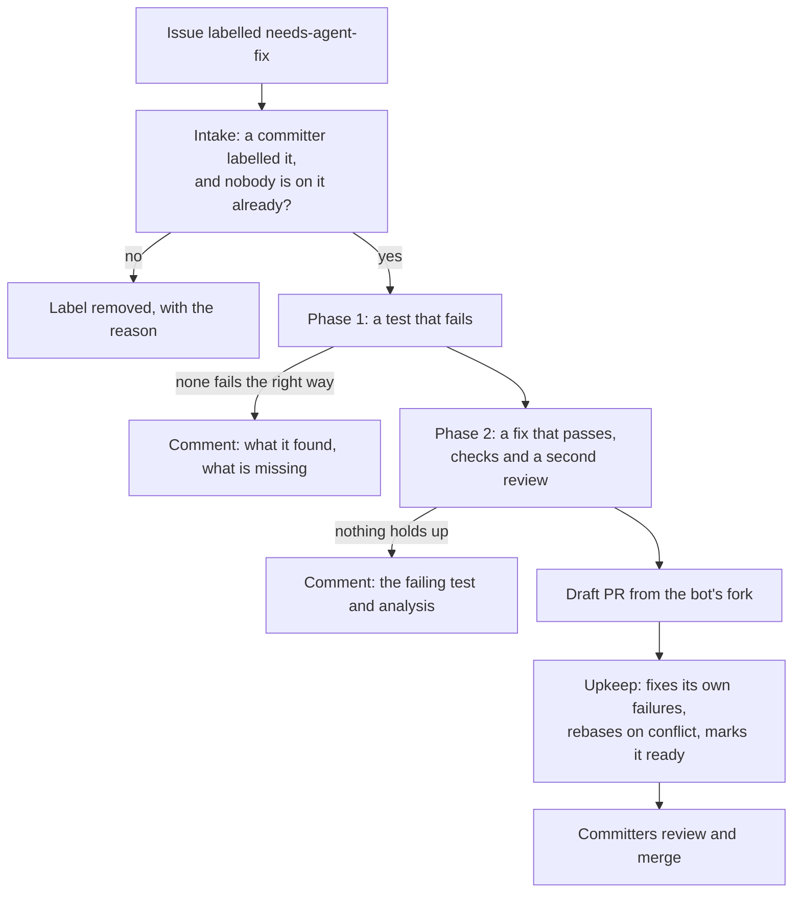
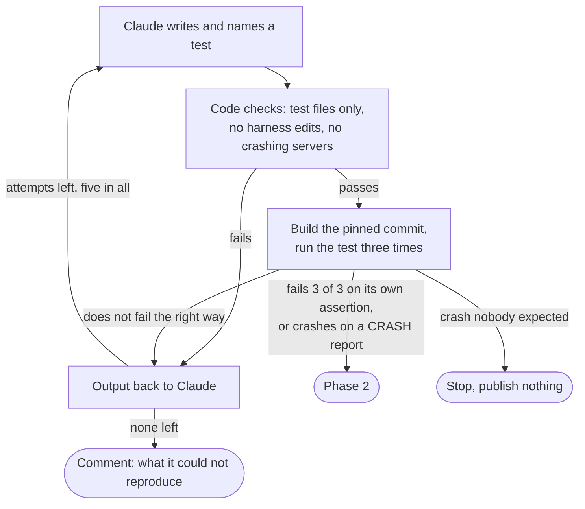
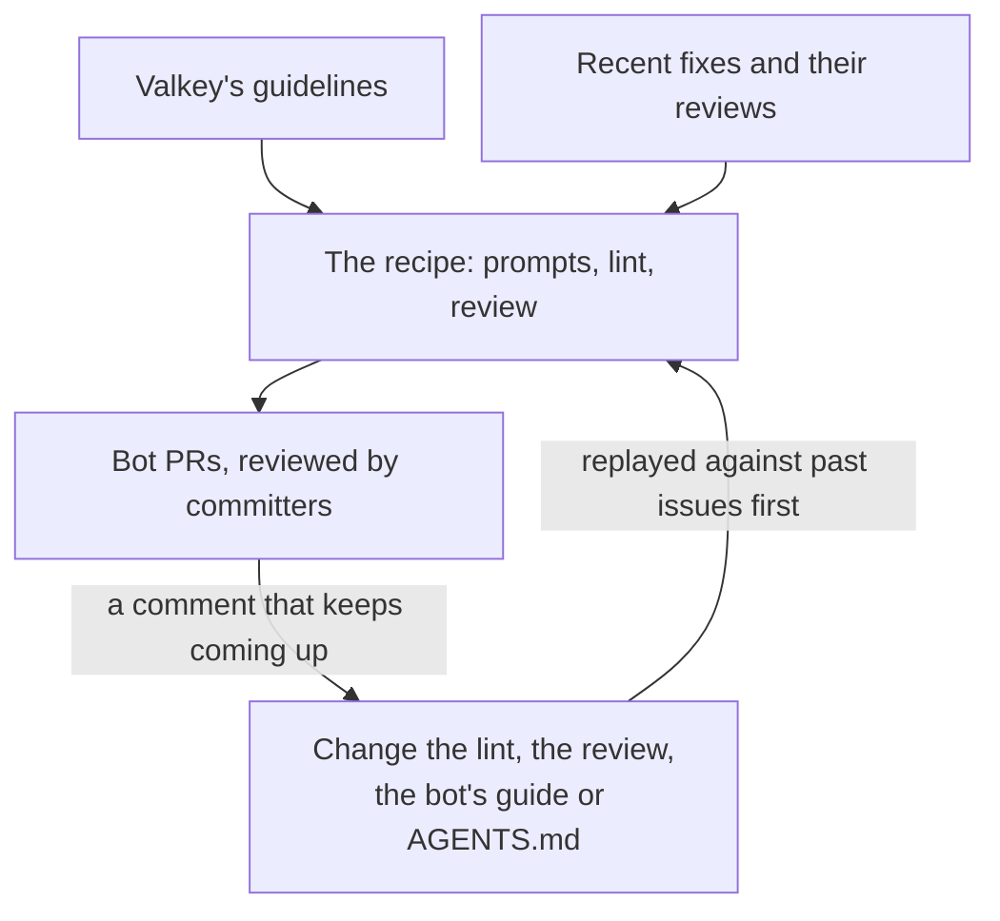
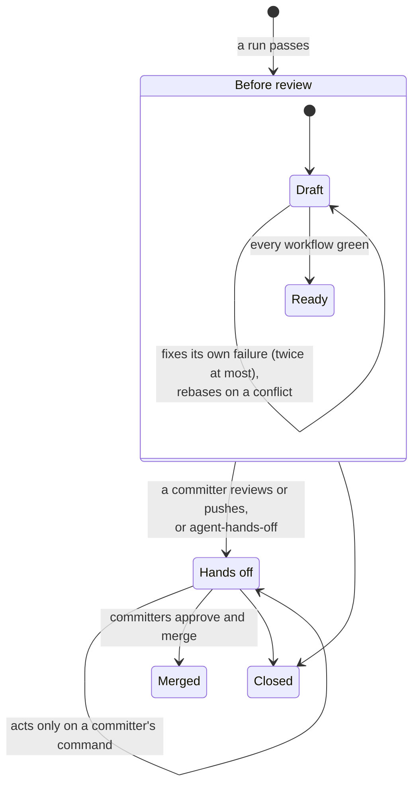
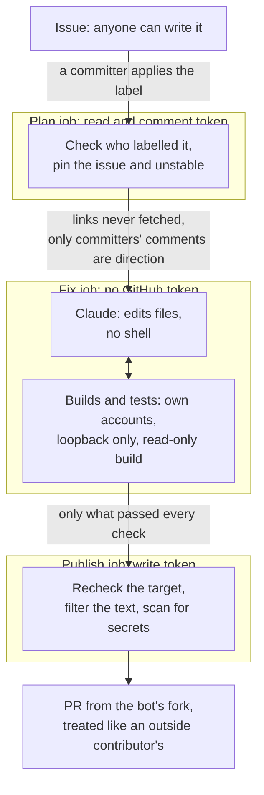

# A software factory for Valkey

*From a labelled issue to a tested pull request.*

Many of us have our own prompts and setup for getting a model to write
code, each with its own idea of when the result is good enough.
That works for one person. It doesn't work for a project: nobody can see
the recipe, improve it for everyone, or say how often it is right. This
post proposes one shared recipe for Valkey, kept in a repository, reviewed
like code, and measured in one place.

In short: a committer puts the label `needs-agent-fix` on an issue. The
bot writes a test that shows the bug, or the agreed behaviour of a small
feature, and then the change that makes the test pass. If both hold up,
it opens a draft pull request and keeps it green, and committers review
and merge it like any other.

`valkey-ci-agent` already runs a CI fix bot that takes a failed CI job, has
Claude propose a fix, verifies it, and posts it. This reuses that engine
and most of the code around it; [what it reuses](#what-it-reuses) maps
each part. What changes is the input: an issue instead of a CI log. It can
be a bug or a small feature whose behaviour is already agreed. New
commands and breaking changes stay out, because they are TSC decisions,
and exploratory work and refactors are outside this proposal's scope.

The goal isn't speed: in a sample of recently closed Valkey bugs, a person
had opened a fix PR for most of them within a day. Review is the slow part
of our process, so the design spends as little review time as possible.

## Four rules

1. **Nothing the bot writes is pushed until code has built it and run its
   test.** A change that can't be verified is posted as a comment, or not
   at all.
2. **The bot never merges or approves.** Committers review and merge its
   PRs like any other.
3. **Only committers can direct it.** Applying the label and every command
   on a bot PR need write access to `valkey-io/valkey`, checked live. A
   label is used because it is a queue anyone can see, waits when the bot
   is busy, and cancels when removed.
4. **It doesn't duplicate people's work.** People often get to a fix
   first, so the bot skips an issue that is assigned or has an open PR
   saying it fixes it, and checks again right before it publishes. The
   detector-issue path already makes both checks.

## How it rolls out

Each step has to earn the next.

1. **Replay.** Run the recipe on 40 recently closed bugs and a set of
   recent small features, writing nothing to Valkey, and count, for each
   kind separately, how often a committer would have merged the result.
2. **Comments.** The label turns on, but the bot only comments with its
   test and patch.
3. **Pull requests.** Draft PRs, at most five open at a time. A revert, or a
   run of PRs closed unmerged, stops new ones.
4. **Review loop.** `@valkeyrie-ops address` applies a committer's review
   comments in one commit, rerunning every check. It never runs unprompted.

Bugs go first in the queue until features have numbers of their own.

The rest of this post goes into the detail: how a run works, the review
it has to pass, the pull request, and how the bot is contained.

## How a run works

A CI fix starts from evidence: a job that failed. An issue is only
someone's description, so the bot's first job is to produce the evidence
itself: for a bug, a test that fails because of the bug; for a feature, the
agreed behaviour written down, and tests that encode it.

**Phase 1: reproduce.** The test may add files, fixtures or test modules
under `tests/` or `src/unit/`, but not touch the harness (`tests/support/`,
`tests/helpers/`, `test_helper.tcl`, the unit-test Makefile). "Its own
assertion" means the runner reports the failure for that test by name: an
`[err]` from runtest with no `[exception]` or timeout, or a `[  FAILED  ]`
from the unit-test binary. A bug's test that fails only because it calls
a command the fix hasn't added yet doesn't count.

Valkey fixes crashes in public, and so does the bot: for a `[CRASH]`
report, a crash is the expected failure. A committer who thinks a bug may
be a vulnerability follows `SECURITY.md` instead of applying the label.

**Phase 2: fix.** The phase 1 test is frozen: code records its hash and
checks it after every build, so the fix can't weaken what it is judged
against. Claude may change other existing tests, usually one that
asserted the buggy behaviour, but only by listing each change and why.
Then code checks that:

- the test passes ten times in a row, and once on an AddressSanitizer build
  with no report;
- every changed test file passes whole;
- `-Werror`, `clang-format` and the generated-file check pass;
- nothing under `.github/` or `deps/` changed, no command was added, and
  the patch is small enough to review in one sitting;
- a second, read-only Claude session fails to break it (next section).

A failure goes back to Claude once. These checks are necessary, not
sufficient: in the sample I read, one merged fix passed all its tests and a
reviewer still found three holes in it.

**Features.** Phase 1 starts by writing the agreed behaviour as a short
list of acceptance criteria, using only the issue and committers'
comments. If Claude can't do that without guessing, because a question is
still open or two options are still being discussed, the run stops and
the bot posts the questions that need answering. Otherwise the tests
encode those criteria and fail first because the feature doesn't exist
yet, the one failure phase 1 accepts for a feature. The criteria go in the
comment or the PR body, so reviewers check the spec as well as the code.

**Detector issues**, the `test-failure` issues the bot's Test Failure
Detector files after a Daily CI failure, keep going through the existing
engine with the failed job as evidence. They are mostly flaky tests, which
don't fail on demand, so the engine can only show the test passing
repeatedly with the fix. Their PRs say that this is a weaker claim.

## Meeting the reviewers' standard

No check can guarantee a fix is the one a committer would have written,
and the reviewer session is the same model reading its own kind of work.
Four things raise the floor.

**Valkey's guidelines:** the ones the CI fix bot already hands its agent:
`AGENTS.md`, `DEVELOPMENT_GUIDE.md`, `tests/README.md` and
`src/unit/README.md`, read from the default branch so a PR can't rewrite
the rules it is judged by. Not `.github/instructions/`: those were added
for Copilot, derive from `DEVELOPMENT_GUIDE.md`, and have mostly not
changed since, and a stale copy is worse than none.

**Recent fixes and their reviews:** the two or three latest merged fixes to
the files being changed, with the review comments they got. Guidelines say
what the standard is; these show it.

**A lint** for what a machine can decide, such as waiting with
`wait_for_condition` instead of a fixed `after`, each rule citing its
guideline.

**A reviewer that has to find a hole.** The second session's job is not
to approve against a list but to find a case the fix still gets wrong: if
the issue describes a failure after a restart, a test that only checks
behaviour before one. For a feature, it looks for a criterion the tests
don't cover, or a reading of the issue the criteria miss. It must name a
specific counterexample, or explain why none exists. When it can write the
counterexample as a test, code runs it, and if that test fails on the
fixed code the fix goes back to Claude with it. The reviewer also rejects
a change that isn't the smallest fix for the cause, doesn't match the code
around it, would be hard to backport, or changes an existing test without
a reason that holds.

Advice that applies to every contributor belongs in `AGENTS.md`, where
everyone's tools read it. Modules would each get their own guidelines,
test runners and lint; `valkey-json` and `valkey-bloom` would first need an
`AGENTS.md`, written with their maintainers.

## The pull request

The PR's body opens with a short summary meant to become the squash commit
message. The rest sits under `

AI generated
details
`, as Valkey PRs already do: the root cause, each change
to an existing test and why, what code verified, and what isn't
established. The bot's commits carry no DCO sign-off; as on its backport
PRs today, a committer approves the DCO check by hand when merging.

**Its own failures only.** When a CI job goes red, the bot checks the same
job on the latest `unstable`. If it's red there too, the failure isn't the
PR's, so the bot names it and leaves it. Otherwise the CI fix bot fixes
it, touching only files the PR already changes. Any other failing test, a
committer can hand over with `@valkeyrie-ops fix`, the command that exists
today.

**Rebasing only on a conflict.** A branch that is merely behind `unstable`
is left alone: `unstable` doesn't require it, and every push reruns CI. On
a conflict, the bot replays its change onto `unstable`, resolves the
conflicted files the way the backport sweep resolves cherry-pick
conflicts, and reruns every check before pushing.

**After review.** A conflict is only reported, and the committer resolves
it as on any contributor's PR, so the bot never rewrites code under a
review. If the bot pushes after an approval, it dismisses the approval,
because `unstable` doesn't and an approval should mean the code that was
read.

## Keeping it contained

Code works out what to act on, checks everything Claude hands back, and
makes every commit and push. Claude is used only where reading and
understanding code is the task. A run is the CI fix bot's three jobs, and
only the outer two can reach GitHub.

A hostile issue may try to steer Claude, and the design assumes that
sometimes works; each step above limits what can follow. Publish also
strips mentions, extra closing keywords and links from everything the
model wrote.

The bot keeps no database and no state of its own. Everything it needs to
remember lives on GitHub:

- the label is the queue;
- the bot's status comment on the issue records what it did, which
  revision it read, and how many runs it has made;
- a marker on the PR counts its CI fixes;
- repository variables hold the kill switch and the rollout step.

Every pass rereads that state, so a run that dies leaves nothing to clean
up, and repeating a pass can't push or post twice. The markers are
bookkeeping, not a security boundary: committers can edit comments.

**Why a fork.** Today the bot pushes backport branches to
`valkey-io/valkey` itself, where CI runs before anyone has read the change,
in jobs holding the Codecov token and CodeQL's write permission. That's
acceptable for cherry-picks of reviewed commits, not for code written from
a stranger's issue, and Valkey's own `AGENTS.md` says agents should never
push upstream. The fork belongs to a machine user, because GitHub won't let
committers push fixups to an organization-owned fork. The bot's token on
`valkey-io/valkey` asks only for pull request and issue write, so it can't
merge.

## What it reuses

Most of the factory already exists in `valkey-ci-agent`.

| Part | Reuses | New |
|---|---|---|
| Intake | The detector-issue dispatcher and `ci-fix-issues.yml`, which already queue one run per issue, two at a time; their checks for an assignee and an open fix PR; the live permission check in `ci_fix/gate.py` | Reading the label event, checking the labeller's role instead of team membership |
| The run | `ci-fix-run.yml`'s plan, fix and publish jobs; the CI fix engine and its two Claude sessions; the separate system account in `common/isolation.py`; the test loops in `ci_fix/verification.py` | A way into the engine without a failed CI job; the reproduce phase, and writing a feature's criteria first; crash detection; loopback-only networking and a read-only build |
| Publishing | `ci_fix/publish.py` and the leased push in `ci_fix/push.py`; the backport registry's `push_repo`, which already pushes to a fork owned by another account | Filtering the model's text and scanning for secrets |
| Fixing CI | The backport CI follow-up, which already watches the bot's PRs and hands one failed job at a time to the CI fix bot; `@valkeyrie-ops fix` for anything a committer wants fixed | Comparing with the same job on `unstable`; following PRs into `unstable`; pushing to a fork head, where `fix` only suggests a patch today |
| Rebasing on conflict | The backport sweep's cherry-pick and Claude conflict resolution in `backport/conflict_resolver.py` | Running it under the fix job's containment |
| Review loop | The release-notes watcher's review-thread reading and replies in `release_notes/review.py` | Applying comments to code rather than one notes file |
| Quality | The bot's guide in `ci_fix/guides/` and the Valkey guidelines it already hands the agent; the replay eval on the `ci-fix-replay-eval` branch | Recent fixes with their reviews, the lint, the counterexample review and running its test, bug and feature cases in the replay |
| State | GitHub only: labels, the bot's comments and repository variables, as every other workflow here | Nothing |

## Open questions

- A fork, as argued above, or branches in `valkey-io/valkey` like
  backports?
- Who funds the model spend? The default model requires Bedrock's provider
  data sharing, so the provider keeps what a run reads and writes.
