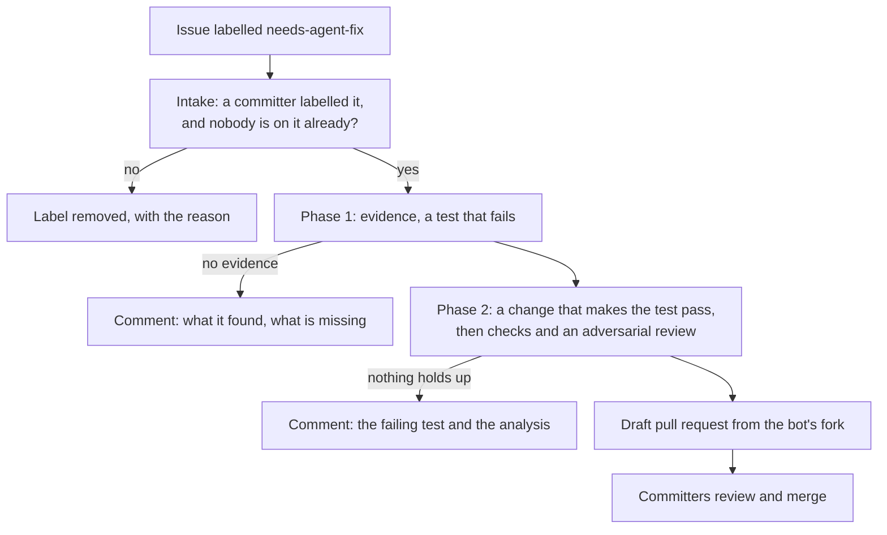
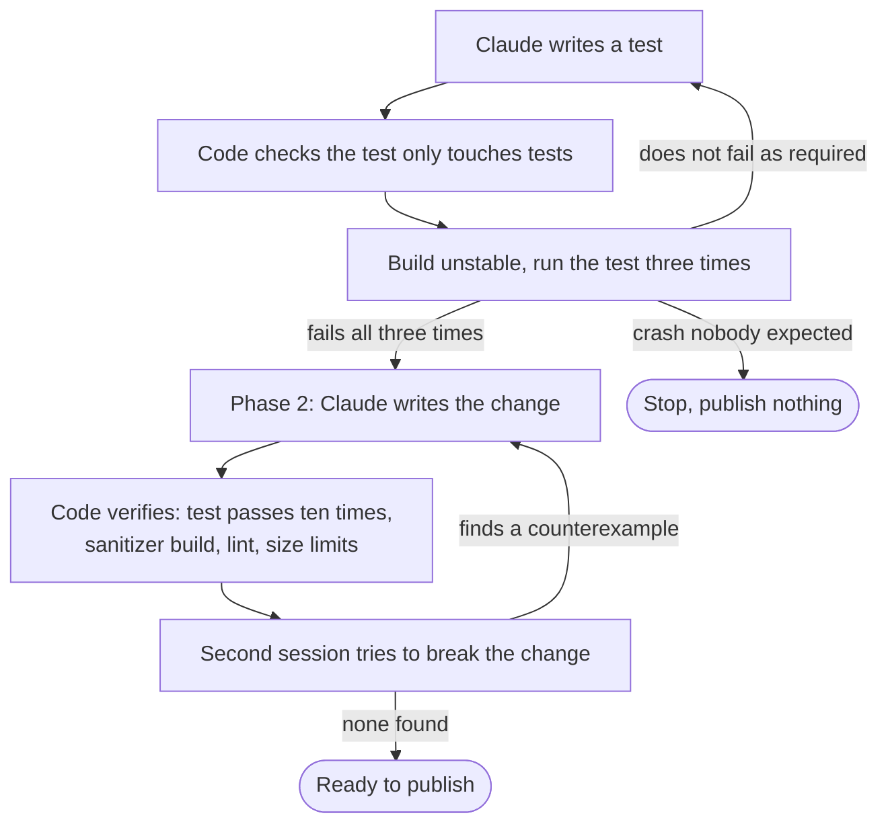
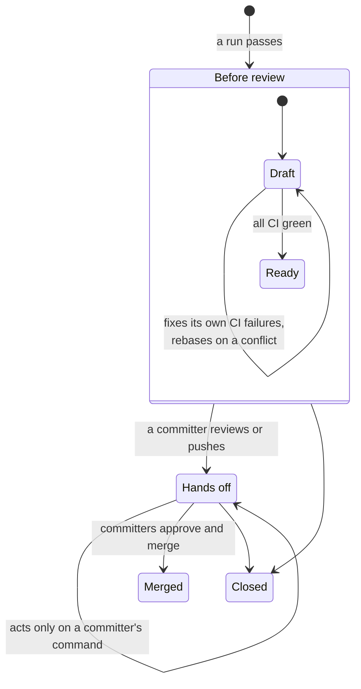
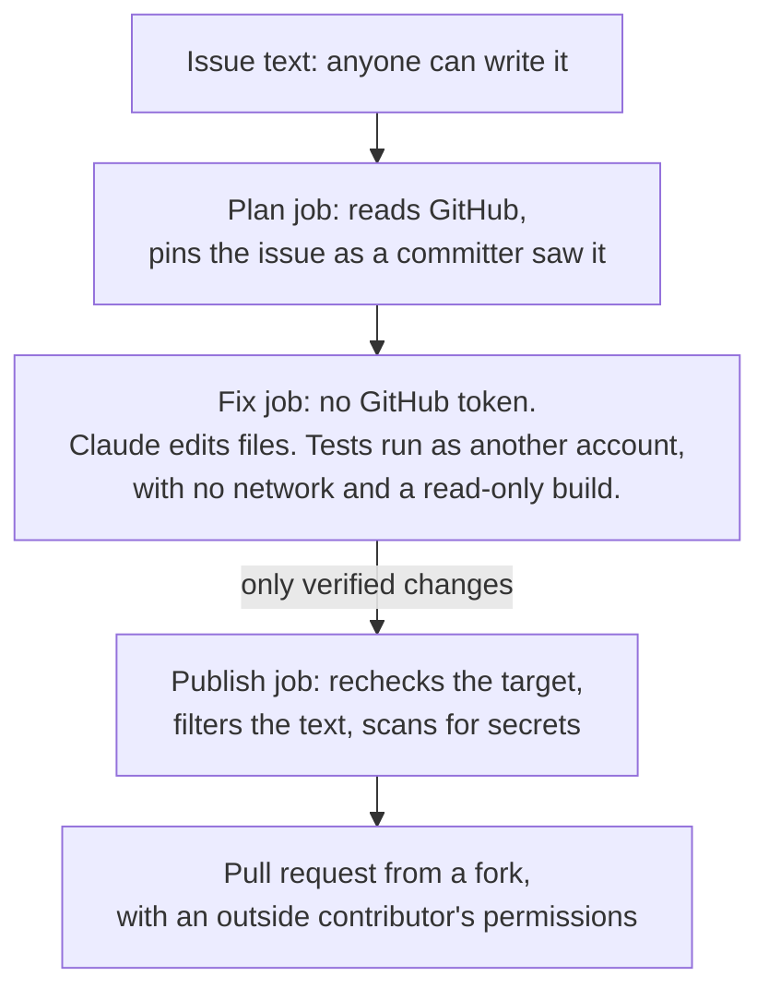

# Design proposal: a software factory for Valkey

*November 2026*

## Executive summary

This document proposes a shared, reviewed way to turn Valkey issues into
tested pull requests. A committer labels an issue `needs-agent-fix`. A bot
writes a test that demonstrates the bug, or encodes the agreed behaviour of
a small feature, then writes the change that makes that test pass, and
opens a draft pull request. Committers review and merge it like any other
pull request. The bot never merges.

The proposal builds on the CI fix bot that `valkey-ci-agent` already runs,
and reuses its engine, its isolation and its publishing path. The new work
is the path from an issue, rather than a failed CI job, to a tested change.
It rolls out in four steps, and the first step replays past issues without
writing anything to Valkey, so the project sees how well the approach
works before it opens a single pull request.

We ask the TSC to decide two things: whether bot pull requests come from a
fork or from branches in `valkey-io/valkey`, and who funds the model usage.

## Tenets

1. **Evidence before code.** The bot publishes a change only with evidence
   that code produced, not the model: a test that fails without the change
   and passes with it.
2. **People decide.** Committers choose the work and review and merge the
   result. The bot proposes.
3. **Don't duplicate people.** The bot stays away from issues someone is
   already working on.
4. **Reuse before building.** Every part of the design starts from code
   that already runs in `valkey-ci-agent`.
5. **No hidden state.** Everything the bot knows lives on GitHub, where
   anyone can read it.

## Background

Many of us now use our own prompts and setups to have a model write code,
each with a different idea of when the result is good enough. That works
for one person. It doesn't work for a project: nobody else can see the
recipe, improve it, or say how often it produces a change worth merging.
The project needs one recipe, kept in a repository, reviewed like code and
measured in one place.

Speed is not the reason. In a sample of the 40 most recently closed bug
issues, a person opened a fix within 24 hours for 23 of the 32 that were
fixed by a pull request. Review is the constraint: `valkey-io/valkey` has
448 open pull requests, and 411 of them are waiting for review. A useful
factory therefore spends as little reviewer time as possible, and it hands
reviewers changes that already carry their own evidence.

`valkey-ci-agent` already runs a CI fix bot. It takes a failed CI job, has
Claude propose a fix, verifies the fix, and posts it as a commit or a
comment. That bot has the hard parts in place: isolation of the model,
verification by code, and safe publishing. What it lacks is a way to start
from an issue.

## Goals and non-goals

The factory has four goals. It turns a labelled bug, or a small feature
whose behaviour is already agreed, into a tested pull request. It holds
every change to the same verification and review standard. It keeps the
cost to reviewers at or below that of a comparable human pull request.
And it measures its results so that the recipe improves over time.

Several things are out of scope. New commands and breaking changes are TSC
decisions and stay with people. Exploratory features and refactors are
outside this proposal. The bot does not replace human review and never
merges or approves.

## Design

### Overview

Each run follows this path. When the bot can't produce evidence, or a
change that holds up, it comments on the issue with what it found, which
still helps whoever picks the issue up.

### Intake

Only committers direct the bot. Applying the label requires write access to
`valkey-io/valkey`, checked at the time the bot reads the label, and the bot
ignores labels applied by other bots. A label works better than a comment
command here because it is a queue anyone can see, it waits while the bot
is busy, and removing it cancels the work.

The bot skips an issue that is assigned or that has an open pull request
claiming to fix it, and repeats that check just before it publishes.

### Producing the change

The bot works in two phases.

**Phase 1 produces the evidence.** For a bug, Claude writes a test that
demonstrates it. Code builds the current `unstable` branch and runs the
test three times. The test counts only if it fails every time, and fails on
its own assertion rather than on a missing command or a broken build. Claude
gets five attempts. For a feature, Claude first writes the agreed behaviour
as a short list of acceptance criteria, using only the issue and committers'
comments. If it can't do that without guessing, the run stops and the bot
posts the questions that need an answer. Otherwise the tests encode those
criteria, and they fail first because the feature doesn't exist yet.

**Phase 2 produces the change.** The test from phase 1 is frozen, so the
change can't weaken what it is judged against. Code then requires the test
to pass ten times in a row and once under AddressSanitizer, requires every
changed test file to pass in full, and runs the same build, formatting and
generated-file checks as Valkey's CI. The change must not touch CI
configuration or vendored dependencies, must not add a command, and must be
small enough to review in one sitting. A failed check goes back to Claude
once.

**Crashes.** Valkey fixes crashes in public with a reproducing test, and so
does the bot. For an issue filed as a crash report, a crash is the expected
failure. A committer who suspects a vulnerability follows `SECURITY.md`
instead of applying the label. A crash that nobody expected stops the run,
and the bot publishes nothing about it.

**Detector issues**, which the bot files for failing tests in Daily CI,
continue through the existing CI fix path, with the failed job as their
evidence. Daily CI failures include flaky tests that don't fail on demand,
so those results state that they show the test passing repeatedly, not
failing first.

### Meeting the reviewers' standard

These checks are necessary but not sufficient. In the sample above, one
merged fix passed all of its tests and a reviewer still found three holes in
it. Four mechanisms raise the quality of the change before a person sees it.

First, the bot reads the guidelines Valkey already gives contributors:
`AGENTS.md`, `DEVELOPMENT_GUIDE.md` and the test READMEs. It reads them from
the default branch, so a pull request can't rewrite the rules it is judged
by. Second, it reads the two or three most recent merged fixes to the files
it is changing, together with their review comments, because examples show
the standard better than rules do. Third, a lint enforces the rules a
machine can check, such as waiting on a condition instead of sleeping for a
fixed time.

Fourth, a second Claude session reviews the change adversarially. Its job is
not to approve against a checklist but to find a case the change still gets
wrong. If the issue describes a failure after a restart, for example, it
challenges a test that only checks behaviour before one. For a feature, it
looks for a criterion the tests miss. It must name a specific counterexample
or explain why none exists, and when it writes the counterexample as a test,
code runs it. A counterexample that fails sends the change back. The
reviewer also rejects changes that are larger than the cause requires, that
don't match the surrounding code, or that would be hard to backport.

When the same review comment recurs on bot pull requests, it becomes a
change to the lint, the reviewer or `AGENTS.md`. Every change to the recipe
is replayed against past issues before it ships, so a correction made once
stays made.

### The pull request

The pull request opens as a draft. Its description starts with a short
summary suitable for the squash commit, and puts the root cause, the
evidence and anything not established under an "AI generated details"
section, as Valkey pull requests already do. The bot's commits carry no DCO
sign-off. As on the bot's backport pull requests today, a committer approves
the DCO check by hand when merging.

Until a committer reviews it, the bot looks after the pull request in two
ways only. It fixes CI failures that its own change caused, which it
confirms by checking that the same job passes on `unstable`, and it does
this at most twice. It rebases onto `unstable` only when there is a merge
conflict, because a branch that is merely behind doesn't need updating and
every push reruns CI. When a committer reviews or pushes, the bot stops
acting on its own and responds only to a committer's request, such as the
existing `@valkeyrie-ops fix` command. If it pushes after an approval, it
dismisses that approval, because an approval must cover the code that was
read.

### Safety

Code decides what to act on, checks everything Claude produces, and makes
every commit and push. Claude reads and edits files in a scratch copy of
the code, and has no other capability.

The new risk is the input. Anyone can write an issue, and a hostile issue
can try to steer the model. The design assumes some attempts will succeed,
and limits what follows. The issue is frozen once a committer has read it. The
job that runs Claude holds no GitHub token. Tests can't reach the network or
alter the built server. Everything the bot posts is filtered for mentions,
links and closing keywords, and scanned for secrets.

The pull requests come from a fork. Today the bot pushes backport branches
to `valkey-io/valkey` itself, where CI runs with the Codecov token and
CodeQL's write permission before anyone reads the change. That is acceptable
for cherry-picks of reviewed commits, and not for code written from an
untrusted issue. A fork gives the bot's pull requests the same permissions
as an outside contributor's, and matches Valkey's own `AGENTS.md`, which says
agents must not push upstream. The bot's token on `valkey-io/valkey` has no
write access to code, so it can't merge.

The bot keeps no database. The label is its queue, its status comment on
the issue records what it did, and repository variables hold its kill switch
and rollout step. Every pass rereads that state from GitHub, so a run that
fails leaves nothing to clean up, and repeating a pass doesn't duplicate a
push or a comment.

## Rollout and success measures

The factory rolls out in four steps, and each step must earn the next.

| Step | What runs | Moves on when |
|---|---|---|
| 1. Replay | The recipe runs on 40 recently closed bugs and a set of recent small features. Nothing is written to Valkey. | At least 1 case in 5 yields a change a committer would merge, reported separately for bugs and features |
| 2. Comments | The label is live. The bot posts its test and change as a comment, with no pull request. | Committers find at least half of 10 such comments useful within 90 days |
| 3. Pull requests | Draft pull requests, at most 5 open at once. Bugs take priority over features. | Of the first 10 pull requests, at least half merge, and none is reverted within 60 days |
| 4. Review loop | On request, the bot applies a committer's review comments in one commit and reruns every check. | |

A reverted bot pull request, or a run of bot pull requests closed without
merging, pauses step 3 until someone has looked at why.

## Risks

| Risk | Mitigation |
|---|---|
| A hostile issue steers the model | No token in the model's job, isolated tests, filtered output, fork permissions, human review |
| The model invents a feature's requirements | Criteria come only from the issue and committers' comments, are shown to reviewers, and an unclear issue stops the run |
| Bot pull requests consume reviewer time | Evidence before publishing, an adversarial review, a cap of 5 open pull requests, and the merge-rate gate |
| Few issues qualify | The replay measures the yield before anything is published |
| A crash reproducer exposes a vulnerability | Labelling is the security call, and an unexpected crash publishes nothing |

## Alternatives considered

**A comment command instead of a label.** A comment carries a hint, but a
label is visible as a queue and cancels cleanly. Checking who applied the
label closes its one weakness.

**Branches in `valkey-io/valkey`, as backports use.** This is simpler, but CI
would run model-written code with repository secrets before review.

**Applying review comments automatically.** This is faster, but it pushes in
the middle of reviews that arrive one comment at a time. In the sample, a
third of review comments were design questions rather than requests for
edits.

**Opening pull requests without a failing test.** This would accept changes
for problems nobody has demonstrated.

## Open questions

1. **Fork or upstream branches.** We recommend a fork owned by a machine
   user, for the reasons in the safety section. The alternative is the
   simpler backport model.
2. **Funding and data.** The bot uses Claude on Bedrock through the AWS
   account `valkey-ci-agent` already uses. The default model requires
   Bedrock's provider data sharing, so the provider retains what a run reads
   and writes. The TSC needs to agree who funds this and accept that setting.

## Appendix A: What the design reuses

| Part | Reuses | New |
|---|---|---|
| Intake | The detector-issue dispatcher, its checks for an assignee or an open fix, and the permission check | Reading the label and its author |
| Producing the change | The CI fix engine, its plan, fix and publish jobs, its isolated account and its test loops | Starting from an issue, the evidence phase, feature criteria, crash detection, network isolation |
| Publishing | The CI fix publisher and its guarded push, and the backport registry's support for pushing to a fork | Filtering and secret scanning of model output |
| Fixing its own CI | The backport CI follow-up and the `@valkeyrie-ops fix` command | Comparing against `unstable`, and following pull requests from a fork |
| Rebasing on conflict | The backport sweep's conflict resolution | Running it inside the fix job's isolation |
| Review loop | The release notes watcher's handling of review threads | Applying comments to code |
| Quality | The bot's guide, the Valkey guidelines it already reads, and the replay evaluation | Past reviews as input, the lint, the adversarial reviewer, issue cases in the replay |

## Appendix B: Sample data

The figures below come from reading pull requests and issues in
`valkey-io/valkey` in November 2026. Nothing was run, so "would fail first"
is a judgement made from the diffs.

| Measure | Value |
|---|---|
| Recently closed bug issues sampled | 40 |
| Of those, fixed by a pull request | 32 |
| Fix pull requests that included a test | 26 of 32 |
| Fix pull requests whose test would fail before the fix on one Linux machine | 21 of 32 at most |
| Fix pull requests opened within 24 hours of the issue | 23 of 32 |
| Median time from opening a fix pull request to merging it | 6.5 days |
| Fix pull requests merged between 23 October and 10 November that fixed a crash, assertion or leak in public | 8 of 20 |
| Open pull requests, and those awaiting review | 448 and 411 |
| Open bug issues with no assignee and no linked pull request | 20 |
