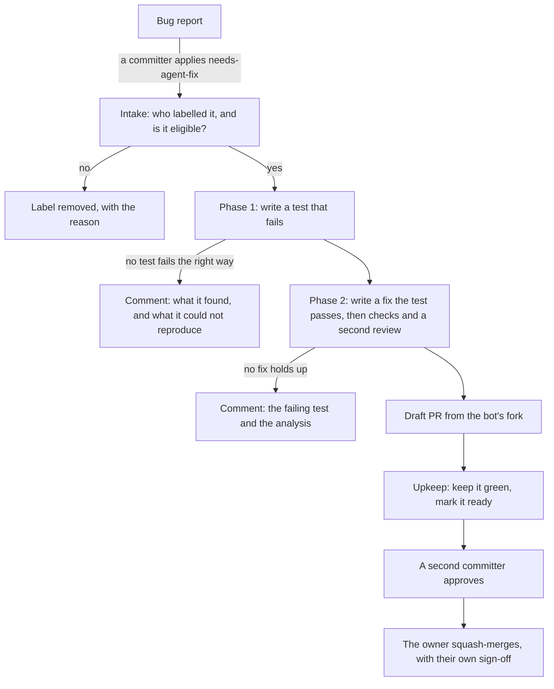
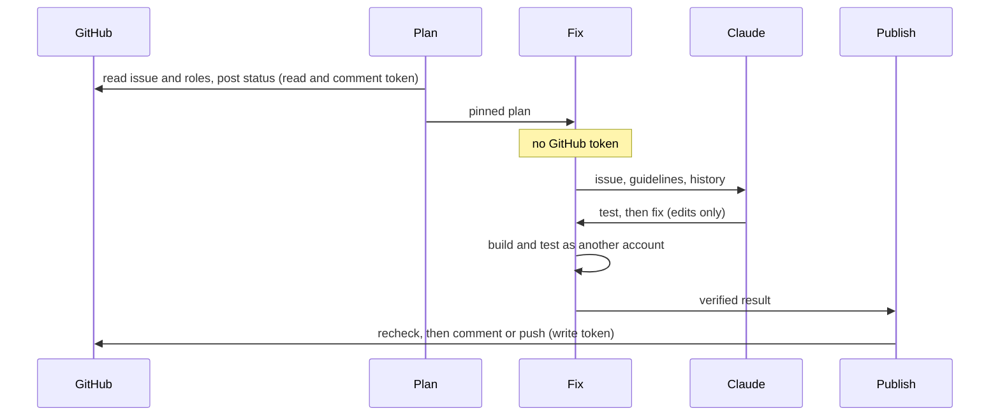
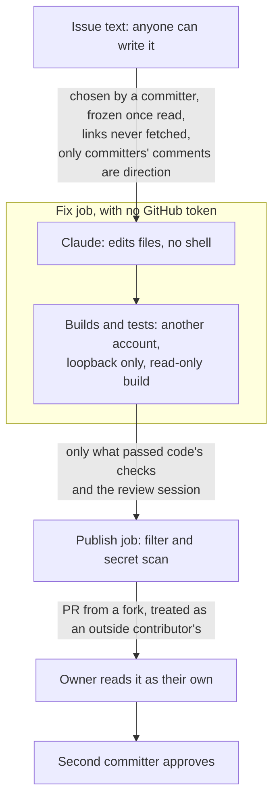
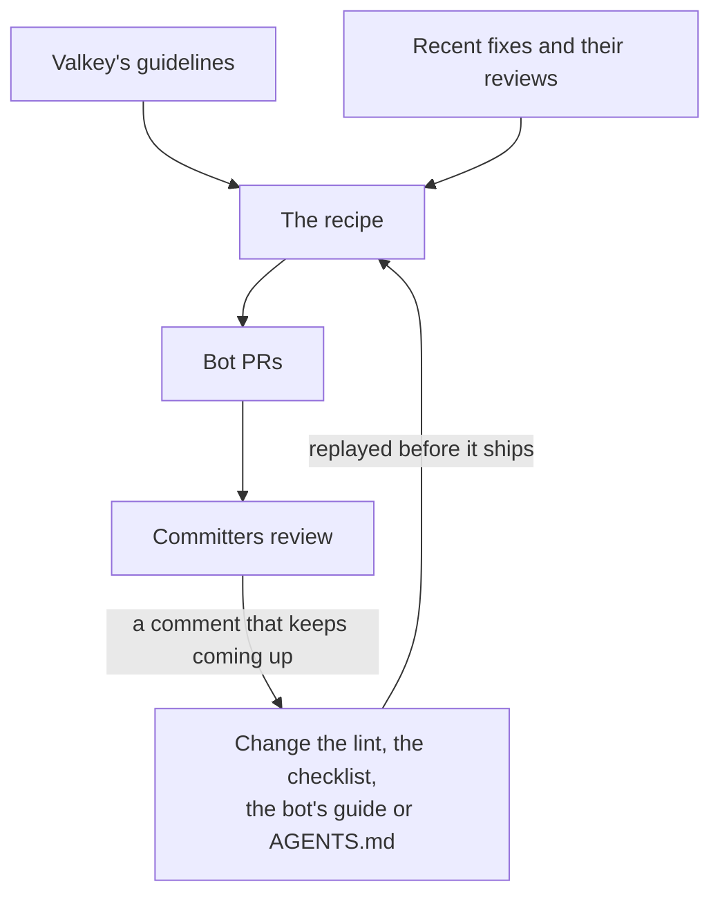
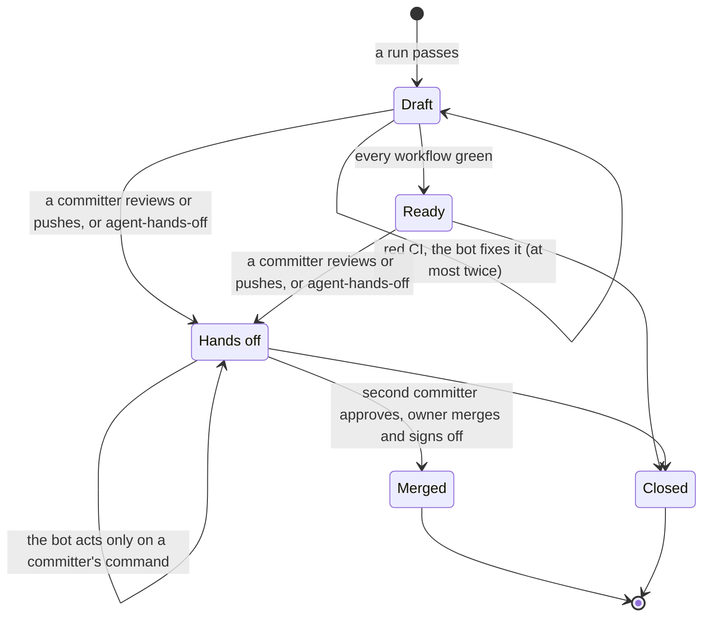
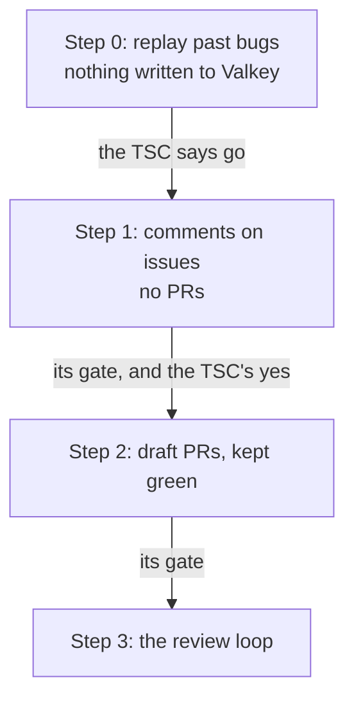

# A software factory for Valkey

*From a labelled issue to a pull request a committer is willing to own.*

Status: proposal, not built yet. Author: Sarthak Aggarwal, November 2026.

Many of us now have our own prompts and our own setup for getting a model
to write code, and each of us has a different idea of when the result is
good enough. That works for one person. It doesn't work for a project,
because nobody can see the recipe, nobody can improve it for everyone, and
nobody can say how often it is right.

This post proposes one shared recipe for Valkey. A committer looks at a bug
report, decides the bot can take it, and puts the label `needs-agent-fix`
on it. The bot writes a test that fails because of the bug, then writes the
change that makes the test pass. If both hold up, it opens a pull request
that says `Fixes #N`. The committer who applied the label owns that PR from
then on, a second committer approves it, and the owner merges it with
their own sign-off. The bot never merges anything.

Speed is not the goal. In a sample of recently closed Valkey bugs, a person
had opened a fix PR for most of them within a day. The slow part of our
process is review, so most of the design is about spending as little
review time as possible.

The bot already exists, in part. `valkey-ci-agent` runs a CI fix bot that
takes a failed CI job, has Claude propose a fix, verifies it, and posts it.
This builds on that engine and on its containment. What changes is where
the work comes from: a bug report, which anyone can write, instead of a CI
log.

## Three rules

Everything else follows from these.

1. **Nothing the bot writes is pushed until code has built it and run its
   test.** A change that can't be verified is posted as a comment, or not at
   all.
2. **Every bot PR has a person who owns it,** and the bot never merges or
   approves.
3. **Only committers can direct it.** Applying the label, and every command
   on a bot PR, needs write access to `valkey-io/valkey`, checked live.

## A failing test is the whole game

A CI fix starts from evidence: a job that failed. A bug report has no such
evidence, only someone's description. So the first thing the bot has to
produce is the evidence itself, a test that fails because of the bug. A fix
without one is a guess, and the bot doesn't publish guesses.

The run has two phases.

**Phase 1: reproduce.** Claude writes a test and names it. It may add test
files, fixtures or test modules under `tests/` or `src/unit/`, but it may
not touch the test harness (`tests/support/`, `tests/helpers/`,
`test_helper.tcl`, the unit-test Makefile), and the test may not kill or
crash servers on purpose. Code then builds the issue's pinned commit of
`unstable` and runs the named test three separate times. It counts only if
all three fail on that test's own assertion, as the runner reports it: an
`[err]` from runtest with no `[exception]` or timeout, or a `[  FAILED  ]`
from the unit-test binary. A test that fails because it calls a command the
fix hasn't added yet doesn't count. Claude gets five attempts.

**Phase 2: fix.** Claude writes the fix. The test from phase 1 is frozen:
code recorded its hash and checks it after every build, so the fix can't
quietly weaken the thing it is judged against. Claude may change other
existing tests, usually one that asserted the buggy behaviour, but only by
listing each change and saying why. Then code checks:

- the test passes ten times in a row, and once more on an AddressSanitizer
  build with no report;
- every test file that changed runs whole;
- the cheap parts of CI pass: `-Werror`, `clang-format`, generated files;
- the change stays focused: nothing under `.github/` or `deps/`, no new
  command, small enough to review in one sitting;
- a second, read-only Claude session reviews the change against a
  checklist (more on that below).

A failure goes back to Claude once. If nothing holds up, the bot still
posts what it found. A failing test on a bug nobody has looked at is
useful to whoever picks it up, even when the bot's fix isn't.

These checks are necessary, not sufficient. In the sample I read, one
merged fix passed all its tests and a reviewer still found three holes in
it. The checks exist to keep PRs that aren't worth a reviewer's time from
reaching one. They don't replace the reviewer.

Detector issues, the `test-failure` issues the bot's Test Failure Detector
files after a Daily CI failure, keep going through the existing engine,
with the failed job as their evidence. Those are mostly flaky tests, which
don't fail on demand, so the engine can only show the test passing
repeatedly with the fix, not failing first. That's a weaker claim, and
their PRs say so.

## Code decides, Claude helps

The agent's existing principle carries over unchanged: code works out what
to act on, checks everything Claude hands back, and makes every commit and
push. Claude is only brought in where reading and understanding code is
the actual task.

A run is three jobs, and only the outer two can talk to GitHub.

**Plan** reads the issue once and pins it, along with who labelled it and
which commit of `unstable` to work on. **Fix** has no GitHub token at all.
Claude edits files there as a separate system account, with no shell. A
different account builds the code, the tree is made read-only to the
account that runs the tests, and tests get no network beyond loopback.
**Publish** checks the destination again, filters what the model wrote
(no stray mentions, no extra closing keywords, no links, a secret scan),
and only then writes.

The genuinely new risk is the input. A bug report is text anyone on the
internet can write, and a hostile one may try to steer Claude. The design
assumes that will sometimes work, and limits what can follow.

### Why the PRs come from a fork

Today the bot pushes its backport branches to `valkey-io/valkey` itself. A
branch there runs CI the moment it's pushed, before anyone has read the
diff, in jobs that hold the Codecov token and CodeQL's write permission.
That's acceptable for cherry-picks of reviewed commits. It isn't for code
written from a stranger's bug report. A PR from a fork gets the same
treatment as any outside contributor's: no secrets in the jobs that run
its code. Valkey's own `AGENTS.md` already says agents should never push
upstream.

So the bot pushes to a fork owned by a machine user (an organization-owned
fork wouldn't let committers push fixups to it), and its token on
`valkey-io/valkey` asks only for pull request and issue write. Merging
needs write on contents, which that token doesn't have.

## Meeting the reviewers' standard

No check can guarantee a fix is the one a committer would have written,
and the reviewer session is the same model reading its own kind of work.
What we can do is raise the floor, in four layers.

**Valkey's own guidelines.** The bot reads `AGENTS.md`,
`DEVELOPMENT_GUIDE.md`, `CONTRIBUTING.md`, `tests/README.md` and
`src/unit/README.md` from the pinned commit. It deliberately skips
`.github/instructions/`. Those files were added for Copilot's reviews,
say they derive from `DEVELOPMENT_GUIDE.md`, and mostly haven't changed
since, and a stale copy is worse than none. Advice in the bot's own guide
that applies to everyone should move into `AGENTS.md`, where every
contributor's tools will read it.

**How committers actually review.** Guidelines say what the standard is;
examples show it. So the bot also reads the two or three most recent merged
fixes to the files it is changing, with the review comments those PRs got.

**A lint, for what a machine can decide.** The rules reviewers keep
repeating, such as waiting with `wait_for_condition` instead of a fixed
`after`, each citing the guideline it comes from.

**A checklist, for what it can't.** The reviewer session rejects a change
that isn't the smallest fix for the cause, doesn't match the code around
it, tests something easier than the issue claims, leaves non-obvious
behaviour unexplained, would be hard to backport, or changes an existing
test without a reason that holds.

The part I care most about is closing the loop. When the same review
comment keeps coming up on bot PRs, it becomes a change to the lint, the
checklist or `AGENTS.md`, and the recipe is replayed against past bugs
before that change ships. A correction made once shouldn't have to be made
again.

When the factory takes on modules, each repository gets its own profile:
its guideline files, what counts as a test and which runner runs it, its
build and format commands, and its lint. `valkey-search` already has an
`AGENTS.md`; `valkey-json` and `valkey-bloom` would need one, written with
their maintainers, first.

## The pull request, and who owns it

A bot PR opens as a draft, with the owner assigned. Its body starts with a
short summary meant to become the squash commit message. The details sit
under `

AI generated details
`, the way Valkey
PRs already do it: the root cause, every change to an existing test and
why, exactly what code verified, and what isn't established. The bot marks
it ready once every workflow on it is green.

Until a committer reviews it, the bot keeps the PR green on its own. It
hands red CI to the CI fix bot, at most twice, and only for files the PR
already changes, so a bug-fix PR doesn't quietly collect fixes for other
people's flaky tests. The moment a committer reviews or pushes, or adds
the label `agent-hands-off`, the bot stops pushing unless asked. If it does
push after an approval, it dismisses the approval, because `unstable`
doesn't, and an approval should mean the code that was actually read.

The owner is the committer who applied the label, or whoever takes the PR
over from them. They answer reviewers as an author would, and they're the
one who merges.

### Who signs the DCO

This is the part that needs the TSC most. Valkey requires a
`Signed-off-by` from a known person on every commit, and a bot can't
certify where code came from, so the bot's commits carry no sign-off. The
DCO check can't be what enforces a human one, either. The DCO app skips
commits authored by bot accounts. It only flags the bot's commits today
because their author email doesn't match a GitHub account, and on backport
PRs a committer then approves the sign-off by hand. If that email were ever
fixed, the check would quietly pass.

So the proposal is that the owner certifies the change as an AI-assisted
contribution of their own. When they squash-merge, they add their
`Signed-off-by` and an `Assisted-by:` line naming the model. GitHub won't
enforce it, so the weekly report flags any merged bot PR that wasn't
squashed, lacks the owner's sign-off, or was approved only by its owner.

## Crashes

Valkey fixes crashes in public, with a test that reproduces them, and the
bot does the same. Deciding whether a bug might be a vulnerability is part
of applying the label: if you think it might be, you follow `SECURITY.md`
instead, exactly as you would for a fix you wrote. For a `[CRASH]` report,
a crash is the expected failure.

The case to guard is a crash nobody expected: the owner labelled what
looked like a wrong result, and the test crashes the server, or the
AddressSanitizer check finds a memory error in existing code. Then the run
stops, and in public it looks exactly like any other run that produced no
result. If the TSC allows it, the test goes into a draft security advisory
that only the owner and the security team can see. For that to mean
anything, runs on bug reports keep the model's session and the test output
out of the public workflow log, and upload nothing until code has
classified the run.

## Rolling it out

Each step is switched on separately and has to earn the next.

**Step 0** replays the recipe on 40 recently closed bugs, closed after the
model's training cutoff, seeing only what each issue said before it was
fixed and `unstable` as it was then. A case counts as publishable only if
the bot's checks pass, the original fixer's own test passes with the bot's
fix, and a committer who didn't write that fix says they'd own the bot's
PR. It also tells us what a run costs. I'd propose going on if at least one
case in five is publishable.

**Step 1** turns the label on, but the bot only comments: its test, its
analysis and its patch. It moves on after ten such comments in 90 days, at
least half of them confirmed useful: either the bot's test failed before a
person's later fix and passed after it, or a committer other than the owner
said the comment helped.

**Step 2** opens draft PRs. It's judged on the first ten: at least half
merged, at least three of those merged with no changes pushed by a person,
review effort no higher than for comparable human fixes, and none reverted
within 60 days.

**Step 3** adds two commands on a bot PR. `@valkeyrie-ops address` applies
the committers' new review comments in one commit, takes `suggestion`
blocks exactly as written, reruns every check, and replies on each thread
without resolving it. `@valkeyrie-ops update` merges `unstable` into the
branch, sending only conflicted files to Claude, and never rebases.
Neither happens unprompted. Reviews arrive one comment at a time from
several people, and a third of the comments in my sample were design
questions, not edits.

A revert of a bot PR, or three in a row closed unmerged, stops new PRs
until the operator has written down what went wrong. A weekly report
tracks how runs end, the review effort each merged PR took next to human
fixes of a similar size, and the review comments that keep recurring.

## What to expect

For this post I read two samples of past work. Nothing was run, so "would
fail first" is a judgement from reading diffs.

| | |
|---|---|
| Of the 32 PRs that fixed the 40 most recently closed `bug` issues: came with a test | 26 |
| … whose test would plausibly fail first on one Ubuntu machine | at most 21 |
| … opened by a person within 24 hours of the issue | 23 |
| … median days from opening to merge | 6.5 |
| Of about 20 fix PRs merged in late October and early November: crashes, assertions or leaks, fixed in public with a test | 8 |
| Open PRs in `valkey-io/valkey` today, and how many await review | 448 and 411 |
| Open `bug` issues today, unassigned, with no linked PR | 20 |

The pool is small. The bot only takes labelled issues, many Valkey fixes
arrive as a PR with no issue at all, and it needs a bug that one test on
one Linux machine can show. Leaks, other platforms, multi-node timing and
performance work are out. The gain isn't volume. It's a shared recipe we
can measure and improve, fixes for bugs nobody has picked up, and failing
tests that help people even when the bot's fix doesn't. Review is the
constraint, so the bot never has more than five PRs open.

## What we need decided

This creates two new roles, the owner of a bot PR and the operator of the
factory, so the TSC may want to treat it as a major decision.

| # | Question | What I propose | Before |
|---|---|---|---|
| 1 | Who certifies a bot's change for the DCO? | The owner, at squash-merge, with `Signed-off-by` and `Assisted-by:`. The squash commit will probably name the bot as its author, and `CONTRIBUTING.md` doesn't accept anonymous contributors, so I'd like the TSC's view, with Linux Foundation counsel if it wants. If the answer is no, we stop at step 0. | Step 1 |
| 2 | Where do bot branches live? | A fork owned by a machine user, with a token limited to that fork. Who owns it, I'll propose before step 2. | Step 2 |
| 3 | Who may apply the label? | Committers. Applying it is also the security call. | Step 1 |
| 4 | Who runs it? | I operate it, with a second operator named before step 1. Admins of `valkey-ci-agent` can switch it off; changes to the recipe need a Valkey committer's approval. | Step 1 |
| 5 | Spend, vendor and data | Claude on Bedrock, through the AWS account the agent already uses, funded by **[to fill in]**. The default model requires Bedrock's provider data sharing, so the provider keeps what a run reads and writes. The TSC sets a budget for step 0 and a monthly ceiling after it. | Step 0 |
| 6 | Go or no-go | One publishable case in five, judged as above. | Step 0 |
| 7 | A private channel for unexpected crashes | Let the App write draft security advisories. Without it, the bot discards the test. | Step 1 |

## What's left for the build

Building this is a real project. The CI fix engine assumes a failed CI job
in every part, so bug reports need a new way in, and the two-phase run, the
crash detection and the locked-down build are new. Steps 0 and 2 are each
large, and step 1 is medium.

The precise rules (the full intake refusal list, the edit rule, the
limits, the exact ready rule, the metrics, the time budgets) will be
settled as each step is built, starting from the longer version of this
document in this branch's history. A handful of GitHub behaviours the
design leans on get checked on a test fork first: whether fork PRs need a
committer to approve their workflow runs, whether the App can open PRs
from a machine user's fork and dismiss approvals, what `unstable`'s "extra
approval for unattributed changes" rule does to an App's PR, and whether
Valkey's tests pass with loopback-only networking.

## Things we chose not to do

**A comment command instead of a label.** A comment can carry a hint, but a
label is a queue anyone can see, waits when the bot is busy, and cancels
when removed. Checking who applied it closes its one weakness.

**Branches in `valkey-io/valkey`, as backports do.** Simpler, at the cost
of CI running bot-written code with secrets before anyone has read it.

**Letting whoever merges certify, with nobody owning the PR.** It asks a
person to sign for code they may only have looked at when they pressed
merge.

**Holding back every crash.** Stricter than the project is with itself, and
it would throw away many of the bugs the bot could fix.

**Acting on reviews without being asked.** Quicker, and it would push in
the middle of reviews that arrive one comment at a time.

**Opening PRs without a failing test.** That would accept fixes for bugs
nobody has demonstrated.
